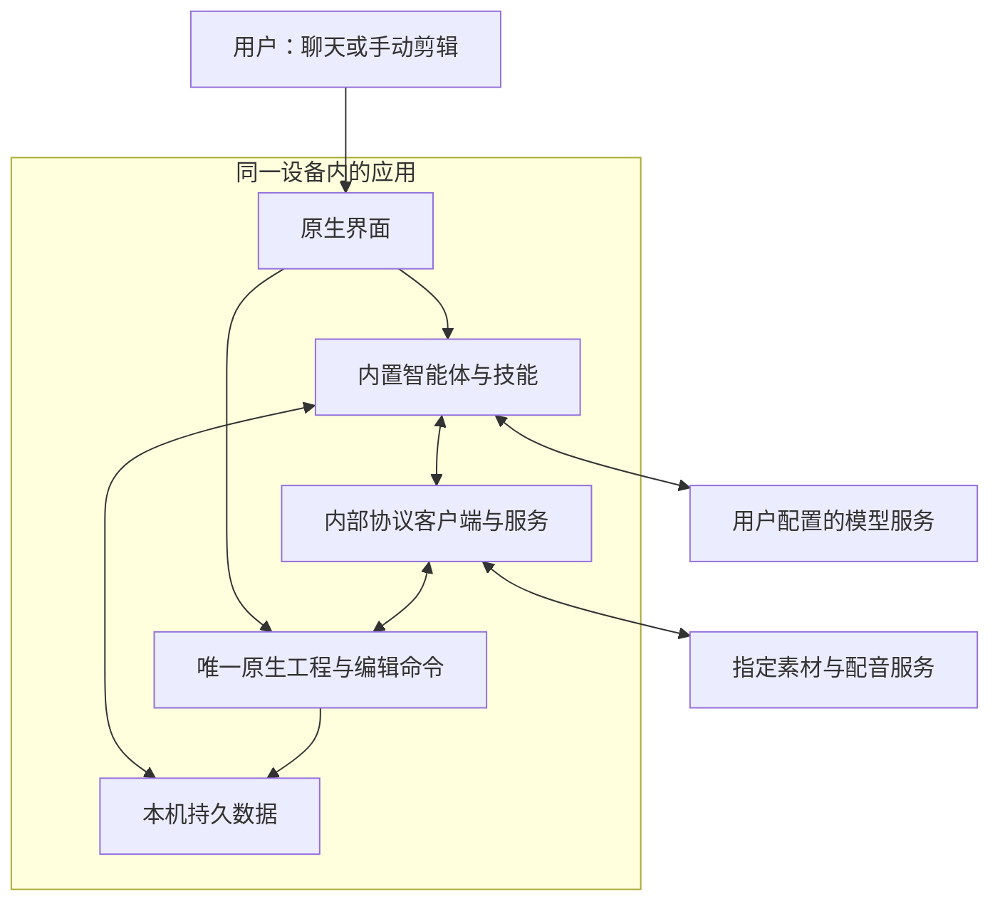

# BK CAT（智能剪辑软件）完整需求文档

文档编号：BK-CAT-20261113（本需求编号）；文档版本：1.1开发基线；总纲版本：0.1版。  
确认状态：**总纲0.1版、完整需求1.0候选版与本轮三项补充均已获用户确认；本文件落实为1.1开发基线。**  
确认依据：用户于2026年11月13日在本轮“请接手我的 BK CAT（智能剪辑软件）项目”执行指令中，明确确认1.0候选版及唯一执行者、锁轨保护、四个崩溃断点三项补充，要求完成文档一致性检查后直接开发，并授权项目范围内必要的修改、测试、构建、安装包、开发分支、提交、推送、拉取请求及满足实际保护规则后的普通合并。该授权不等于外部服务、设备、密钥和收费预算已具备。  
资料覆盖：完整读取上一轮753行需求原件、独立总纲及对话镜像、本轮执行指令，以及用户已有需求技能、详细模板和审查规则。上一轮技术来源与审查结论按历史证据保留；本轮另核验固定上游和实际仓库。未读取的完整历史与未执行产品测试不冒充已有证据。  
现场状态：已找回1.0原件；现有公开派生仓库 beyondchenlin/Concat（既存剪辑软件仓库）在初查时仅有 main（上游主分支），提交 e980f576937263aa3b3b3d87e20c8db1c47fb02b，未发现本产品既有代码。仓库和目录已集中征询一次但未取得新输入，执行代理据当前执行规则采用推荐方案：复用该现有仓库，用户电脑开发目录选定为 E:\BK-CAT（初查不存在的本项目专用目录）；这是本轮执行选择，不记录为用户另行明确选择。已实际克隆至 E:\BK-CAT（本地开发目录），origin（二开远端）为 beyondchenlin/Concat（现有仓库），upstream（上游远端）为 jub0t/Concat（官方仓库）；main（纯净上游镜像分支）位于6584d34971ae5e168f12cb475bdf58055b67d780，dev（二开集成分支）及 feature/bk-cat-m1-guards（首个里程碑保护功能分支）冻结在 v0.2.10（原生版本）提交71efe1f4ec1428723e98f75398ecf6167d7e9110。以上为初始化及第一批交付记录，不代表当前分支头提交。2026年11月13日本轮接续核验的源码基点为fb85eb72086e29e71c8ff6a5dbfb0f2de494477c；已存在原生保护桥、固定原版运行脚本、原生会话数据库端口、操作日志及原生聊天布局。已读取第二批既有日志：原生回归488项通过、8项按原配置忽略；原生聊天状态测试5项通过，原生库构建检查完成。上述为第二批既有验证记录，不冒充第三批重跑。第三批已编码桌面及安卓受控网页宿主、固定资源加载、网页与原生消息路由、原版会话数据库接线、当前工程内部协议执行及真实保存回调；下文记录新增代码和限定验证范围。隔离原生窗口与平台共存验证示例已编写，实际构建和执行结果待记录；完整安卓构建、安卓真机、两端真实模型闭环、安装包及九组产品验收均未执行。
编写日期：2026年11月13日，北京时间。原件保留于 /workspace/scratch/a65fecc9ac5c/docs/prd/bk-cat-20261113/（上一轮会话需求目录）；本修订文件位于 /workspace/scratch/95e66a9d8452/docs/prd/bk-cat-20261113/（本轮会话需求目录）。两者均不是用户电脑上的产品项目目录；原件、总纲、对话镜像和本修订版已实际纳入 E:\BK-CAT\docs\prd\bk-cat-20261113（本产品需求目录），原件与总纲摘要已核验一致。

## 总纲镜像

以下内容从独立总纲原样复制，不分别编辑。总纲0.1版原文保持不变；后续正文展开其中九项功能，并落实用户已确认的1.1补充，不重新编号。

<!-- 总纲开始 -->
# BK CAT（智能剪辑软件）需求总纲｜0.1版

## 一句话目的

面向制作简单短视频的用户，基于开源剪辑软件打造电脑与安卓均可独立使用的聊天式剪辑产品，实现文案创作、素材检索、自动剪辑和可继续手动编辑的原生工程交付。

## 技术栈

- 语言：沿用 Rust（系统编程语言）剪辑核心，以 TypeScript（类型化脚本语言）接入智能体。
- 仓库：基于 Concat（剪辑软件）独立二开，单独移植601当前工程桥；上游镜像、二开开发、正式发布分离；新仓库名称与本地目录待确认。
- 界面：沿用 Slint（原生界面框架），增加聊天主界面和文案入口，保留原生时间线与预览。
- 智能体：内置 Pi（智能体框架）的原版模型接入与持久会话组件，固定依赖版本。
- 运行：安卓采用 WebView（内嵌网页运行组件），电脑采用 WebView2（微软内嵌网页运行组件）；与现有原生窗口共存须先完成两端验证。
- 工具：内部通过 Skill（技能包）与 MCP（模型上下文协议）执行，复用原剪辑命令、批量编辑和撤销体系；外部接入共用工具定义。
- 数据：原生工程保存剪辑结果，SQLite（嵌入式数据库）保存对话和任务；文案独立版本化，密钥使用系统安全存储。
- 服务：模型联网调用，预览和视频导出优先在本机执行；服务器承担素材存储与检索，素材服务接口、配音渠道和付费预算待确认。

## 功能清单

- 功能01：独立双端应用。首版支持 Windows（微软桌面系统）和安卓，各自安装后即可配置模型并工作，不依赖另一台电脑、外部智能体或额外终端环境；苹果端后续安排，最低系统版本与测试设备待确认。
- 功能02：聊天式主界面。电脑采用项目列表、聊天、视频预览布局；手机以聊天和预览卡片为主，提供文案和手动剪辑入口；原有剪辑功能保留。先确定交互布局并打通真实流程，再精修视觉，精修后重新验证功能。
- 功能03：内置智能体与模板选择。用户选择模型、填写接口密钥后，可持续对话、查看任务步骤、停止任务、选择内置剪辑技能；首版至少验证两种模型渠道，具体名单待确认。首版完成内部协议执行，对外接入界面及第三方任意技能安装后续安排。
- 功能04：独立文案工作区。支持新建、粘贴、生成、改写、手动编辑和版本保存；选定的文案版本作为本次剪辑依据，不只保存在聊天记录中。
- 功能05：本地与服务器素材检索。用户授权本地素材，或连接指定素材服务后搜索、预览、选择并下载所需片段；能够追溯素材来源。素材服务地址、鉴权及现有索引能力待确认，不把未接通的服务当成已完成能力。
- 功能06：简单短片自动剪辑。首版提供一条主视频轨模板，按文案组织素材，并按模板配置加入字幕、贴片文字、背景音乐和配音；字幕、文字和音频保持独立可编辑。使用实际素材与声音时长生成剪辑计划，不用模板限制原软件的高级能力。
- 功能07：对话与手动剪辑共用工程。智能体修改当前打开的工程，时间线和预览同步更新；用户可继续用自然语言修改或手动调整，两种操作进入同一套撤销、重做历史。
- 功能08：保存原生工程与本机导出。工程保存后能在同一设备重新打开并继续编辑，满意后直接导出视频；缺失素材、保存失败和导出失败必须明确提示。首版不承诺跨设备无缝接力或实时多人协作，导出规格与验收样片待确认。
- 功能09：操作保护与中断恢复。限制素材访问范围，保护接口密钥；上传本地素材、删除源素材须确认；重复请求不得重复剪辑，旧计划不得写入已切换或已变更的工程。应用中断后保留已落盘工程与任务状态，再次打开先核对结果，未完成的收费任务由用户选择继续；不承诺应用被关闭后持续执行。

## 验收标准

- 验收01 → 功能01：在约定电脑和安卓真机上安装正式安装包，配置可用模型后分别完成一次剪辑；需要额外安装终端、依赖电脑代替手机执行，或任一端不能独立完成，均视为未通过。
- 验收02 → 功能02：从聊天进入文案、预览和原生编辑界面，再返回聊天，会话和当前工程保持一致；任务进度、停止和错误提示可见。视觉精修后再次执行核心流程；入口不可达、切换丢内容或原功能退化视为未通过。
- 验收03 → 功能03：使用两个已确认模型渠道分别加载内置技能并完成实际工具调用，能查看执行结果并停止后续步骤；仅生成文字而未剪辑、虚报执行成功，或不支持的模型未明确报错，视为未通过。
- 验收04 → 功能04：生成文案后手动修改、保存版本并重新打开，内容保持一致；剪辑使用用户选定的版本。只显示聊天文字、文案修改丢失或使用错误版本视为未通过。
- 验收05 → 功能05：分别从已授权本地素材与已连接服务器检索真实样本，预览并用于工程，能够确认来源；服务断开、鉴权失败或文件不可用时明确提示。虚构检索结果、越权读取或把不可用素材当成可剪辑素材视为未通过。
- 验收06 → 功能06：用约定文案和素材完成一条模板短片，主轨顺序、画面时长及字幕、文字、音乐、配音与有效剪辑计划一致，各元素能够单独编辑；缺素材仍冒充完成、静默丢轨或只输出无法二次编辑的成片视为未通过。
- 验收07 → 功能07：向当前工程批量添加两段字幕，界面立即反映修改，一次撤销恢复该批改动，重做后再手动调整并继续对话修改；出现两份不同工程、时间线不同步或撤销错乱视为未通过。
- 验收08 → 功能08：保存后关闭并重新打开，素材引用、片段、文字、音频和时间设置保持一致，能继续编辑并按约定规格导出；工程不能重开、保存失败仍报成功、缺失素材不提示或导出内容与工程不一致视为未通过。
- 验收09 → 功能09：测试重复提交、超时、中断重启、工程切换、手动修改后提交旧计划及未授权访问，必须按真实操作状态恢复或拒绝；重复剪辑、写错工程、未确认上传或删除源素材、日志泄露密钥，任一出现即视为未通过。

<!-- 总纲结束 -->

## 技术栈说明

### 1. 总体实现原则

产品的核心是“自然语言发起剪辑，真实工程接受修改，用户看得到且能撤销”，不是聊天模型自行生成一份与编辑器脱节的文件。

| 层次 | 固定职责 | 不承担的职责 |
|---|---|---|
| Slint（原生界面框架） | 项目列表、聊天、文案、预览及原有手动编辑入口；呈现真实执行状态 | 不自行推断工具已成功，不保存第二份可写时间线 |
| Pi（智能体框架）原版组件 | 接入模型、组织多轮会话、调用工具、持久化执行上下文 | 不替代剪辑引擎，不默认拥有任意文件或系统命令权限 |
| Skill（技能包） | 给出模板规则、编辑策略、参数约束和工具使用说明 | 不直接授予权限，不是视频渲染器，不保证一次模型输出就正确 |
| MCP（模型上下文协议） | 统一内部工具发现、调用、错误与结果语义，给后续外部接入保留复用点 | 不自动实现剪辑能力，不自动解决鉴权、撤销或许可证问题 |
| 当前工程桥 | 将通过校验的请求投递到原生工程所属线程，更新界面与同一撤销历史 | 不创建独立可写工程后覆盖当前工程，不在界面线程等待自身 |
| Rust（系统编程语言）原生剪辑核心 | 片段、轨道、时间、字幕、音频、预览、保存及导出 | 不依赖聊天记录重建唯一工程，不把视频逐帧交给智能体执行 |
| 本机持久层与系统安全存储 | 会话、文案版本、任务回执和密钥保护 | 不把接口密钥写入工程、技能包、普通数据库字段或日志 |

“用户填密钥即可工作”是成品使用方式；内部仍须具备智能体、技能加载、工具执行、工程桥和恢复机制。复用现有组件减少重复实现，但不等于安装几个依赖即可交付。

### 2. 版本锁定与复用边界

| 对象 | 本次文档采用的证据基线 | 实施要求 |
|---|---|---|
| Concat（剪辑软件）第601号拉取请求 | 头提交 268860a89f5f21dfdfcb770c3b5e30952fd350be；本轮读取时仍打开、未合并且存在合并冲突 | 作为移植来源，不将该分支直接当正式发布基线 |
| 正式二开基线 | 复用 beyondchenlin/Concat（既有公开派生仓库）与 E:\BK-CAT（本地开发目录）；二开分支冻结 v0.2.10（原生版本）提交71efe1f4ec1428723e98f75398ecf6167d7e9110 | 原生核心及工程测试已实际通过；完整双端构建尚未执行，不能据单元测试宣称可发布基线。单独移植601相关改动，不用镜像分支最新提交替换固定参考 |
| Pi（智能体框架） | 提交 d36266e06669c6991a7c9509d1da04d18d30378d；模型接入与持久会话组件均为1.5.2 | 固定实际包版本、依赖锁文件和宿主适配；禁止运行时追随最新版本 |
| pi-ai（模型接入组件） | 使用原版按需供应商入口 | 只暴露实际通过双端验证的密钥渠道；不把全部供应商列表当成已支持范围 |
| pi-durable（持久会话组件） | 原版说明明确标为实验性，接口能在版本间无预告改变 | 封装宿主接口，升级需回归；不再并行建立第二套智能体调度循环 |
| 协议客户端 | 使用运行时中立的官方客户端与自定义消息传输；具体包版本在宿主验证阶段锁定 | 不直接假定 Pi（智能体框架）默认协议客户端入口能在网页运行组件中打包 |
| 需求编写技能 | oceans777/prd-skill（用户产品需求技能仓库），提交 5e5ed4c542553174cc7f8efe94d836dc57794eae | 沿用其详细模板、总纲镜像及两轮审查规则 |

已核验的原版协议客户端默认入口包含进程启动等服务端依赖；持久会话的服务器数据库驱动也不是手机直接可用的驱动。实施时使用可移植入口和原生数据库适配，不能用空实现屏蔽依赖后宣称功能完整。

本轮固定源码复核补充：原版持久会话的数据库打开会执行建表或迁移；只在随后打开智能体宿主时传入只读选项，不能使前面的数据库打开变成只读。独占所有权必须先于该可写存储入口取得；第二实例首版可明确拒绝进入。独立只读查看另行验证存储打开本身没有写入，不能只凭宿主的只读选项判定。

技能资源加载、模板选择和应用权限策略由本产品宿主实现。原版组件提供扩展与工具入口，不自动附带本产品的剪辑技能、模板市场或手机权限处理。

### 3. 运行拓扑与数据边界

以下为本产品既定运行拓扑，当前已有部分组件及接线代码，完整两端流程尚未验收。图中所有“本机”组件均属于同一个安装应用；两台设备各自执行，不以电脑代替手机运行。



- 模型接收完成本次任务所需的文本与经授权数据，不默认上传完整本地视频。
- 模板生成的结构化计划可以独立保存；它是待执行意图，不是第二个可编辑工程。
- 视频解码、音频处理、预览和导出留在原生侧；大文件不通过脚本消息桥整体编码传递。
- 服务器素材是外部数据来源，不获得本地工程的直接写权限；下载完成后按本地素材规则进入工程。
- 原生工程与会话数据库是两种持久对象，不能声称一次数据库提交就同时完成了工程文件保存。

### 4. 双端内嵌运行方案与前置验证

桌面采用 WebView2（微软内嵌网页运行组件），安卓采用 WebView（内嵌网页运行组件），加载同一份受控脚本包。它们承载智能体脚本运行；聊天与编辑器仍沿用已确认的原生界面方案，不新增一套替代编辑器。

宿主适配至少提供：安全模型请求与流式返回、取消、数据库事务、会话存储独占所有权及宿主代次校验、受限资源读取、系统安全存储、内部协议消息、事件通知及生命周期管理。模型密钥由原生网络适配按已确认渠道注入；不得作为普通对话数据交给模型或技能读取。模型渠道适配所需的字段传递方式须在宿主验证中证明。

安卓上游使用原生活动宿主，并非已经准备好的网页容器。新增运行组件必须验证活动、线程、窗口、输入焦点及切后台行为，不能把另一个手机项目能运行当作本应用已通过。

桌面安装程序负责检查并部署所需运行组件；用户不安装开发环境。自动更新运行组件或固定随包分发的具体方式，在安装验证中记录选择、体积、更新与回归责任，不预先虚报安装包大小。

**门槛一：双端宿主验证，先于大规模功能扩展。**

1. 在原有桌面程序和安卓真机程序中分别启动受控智能体脚本，不破坏原生窗口、预览或输入。
2. 完成一次真实流式模型请求、一次取消、一次持久化重开；收费请求以获得测试授权和预算为前提。
3. 从脚本通过真实内部协议调用只读工具，再调用原生批量编辑工具。
4. 两段字幕进入当前打开工程，显示在时间线上，一次撤销恢复该批改动，重做恢复。
5. 手动调整后继续对话修改，使用同一工程和同一历史；工程切换、旧计划、重复请求、锁轨和迟到回调均受到保护。
6. 同一会话存储开启可写会话或调度前取得独占所有权；桌面两个进程共用该存储，以及安卓新旧运行组件重叠时，始终只有一个有效执行者。
7. 切后台、窗口关闭、运行组件重建及应用重启后，不复活旧队列，不自动发起收费调用；异常恢复先核对，用户选择继续后按当前工程、会话和版本重新校验。
8. 保存成功具有目标版本真实落盘证据，不以“已请求保存”替代。
9. 任何一端未通过，记录阻断原因并修复；不得删去安卓范围、改成远程电脑代跑或换掉已确认技术栈。确需变更时说明原因并另获用户确认。

这些是功能01、功能03、功能07、功能09的前置技术检查，不是新增用户功能；当前全部未执行。

### 5. 第601号改动的移植方式

复用：当前窗口会话访问、事件线程投递、原生编辑命令、批量编辑、撤销与重做，以及编辑后发布界面状态。

必须补齐：

- 使用工程身份、打开会话身份及版本共同校验目标，不能只比较文件路径。
- 等待超时只进入“待核对”，不把超时解释为“肯定没执行”后重发。
- 队列中的写入在原生编辑线程真正执行前再次检查取消状态、权限、工程版本、会话存储所有权与宿主代次；校验和提交处于同一不可被锁轨或所有权变更插入的编辑临界区。
- 601原始脚本入口未完整覆盖窗口层锁轨保护。对批次全部受影响轨道检查执行时的当前锁定状态；跨轨移动同时覆盖来源和目标，复合命令覆盖其子命令触及轨道。无法确定影响范围时拒绝执行。计划生成后用户新增锁定同样生效；任一轨道锁定则整批拒绝，不隐式解锁、不局部提交。用户主动解锁后重新读取当前状态、重新校验再提交。
- 保存提供真实落盘成功或失败的完成事件，不能将“已经请求保存”显示成“已保存”。
- 安卓有自己的内置调用入口，不依赖上游仅在桌面展示的自动化设置页。
- 编辑期间不抢占用户进行中的拖动手势；等待手势结束或明确拒绝并提示重试，执行前重新核对版本。
- 批量操作前严格检查对象存在性及参数，操作后读回结果；原生命令的无操作返回不能冒充完成。
- 新建轨道、素材和片段的关联需要统一标识映射。原生批量命令只返回最后生成的标识，不能直接用它推断整个批次的对象清单。

原生批量编辑在工程数据层具备整批成功或整批不提交的语义，并对应一个撤销步骤；下载、配音请求、外部文件和保存过程不属于这一个原子操作。外部资源先准备并验证，再提交工程批次。

### 6. 内部协议与技能共用方式

内部链路必须使用真实 MCP（模型上下文协议），按锁定共同版本验证初始化或服务发现、版本声明或协商、工具调用、取消及结果关联。601固定参考及产品冻结基线均包含两种模式：2026-07-28版采用逐请求版本声明和服务发现；四个旧版采用初始化握手。两端客户端与服务端应锁定实际共同支持的版本，不把某一种握手形式强加给全部版本，也不能把普通函数调用改名后作为协议验收证据。

本轮重新核对固定源码后的兼容事实：Pi（智能体框架）1.5.2所带协议客户端最高声明2025-11-25，并以 initialize（初始化请求）握手、核对返回版本及发送初始化完成通知。产品冻结提交71efe1f4ec1428723e98f75398ecf6167d7e9110与601固定参考268860a89f5f21dfdfcb770c3b5e30952fd350be的协议服务均已支持2025-11-25、2025-06-18、2025-03-26和2024-11-05：初始化请求声明受支持旧版时，服务返回该请求版本。因此两者在版本与初始化源码合同上具备共同支持的2025-11-25；不能把现代模式的版本常量当成服务唯一支持版本。实施时复用现有旧版兼容分支，锁定该共同版本，继续验证私有消息传输、工具定义、参数校验、取消和结果关联。对无共同支持版本的连接必须拒绝。固定原版组件隔离测试和网页脚本打包已运行，既有记录见第二批开发说明；其中隔离验证覆盖原版协议调用身份、网页入口门禁和原版会话数据库重开。第三批已编码平台私有消息传输、原生当前窗口路由、固定协议版本握手及原版调用身份校验；当前两端实际互通验收尚未完成，不将源码兼容判定、接线代码或隔离测试写成联调完成。

- 通过私有双向消息桥，将运行时中立的客户端连接到原生服务；原生服务复用现有通用输入输出入口，不要求启动命令行子进程。
- 内部无需开放公网端口；消息桥使用应用内可信通道，并校验会话、请求标识、消息格式及允许的方法。
- 原生侧是工具定义及执行规则的唯一来源，脚本侧按定义注册工具。版本不匹配时拒绝执行，不维护两套含义不同的工具表。
- 内部模板只使用明确的工具白名单。第一版不加载外部任意脚本，不提供任意系统命令执行能力。
- 后续对外接入复用同一工具定义、参数校验与原生执行入口；外部认证、发现、连接配置和权限审批仍需单独完成。本版不把这些工作记作已交付。

| 工具能力组 | 本版行为 | 原生结果要求 |
|---|---|---|
| 工程与能力读取 | 返回当前工程身份、版本、轨道与可用功能摘要 | 不泄露无关目录或密钥 |
| 文案与技能资源 | 读取指定版本及本次选定模板规则 | 未保存版本与缺失资源明确报错 |
| 素材搜索与准备 | 搜索已授权来源，下载所选内容并探测时长 | 未就绪素材不得进入可执行计划 |
| 计划校验与批量编辑 | 校验对象、时间范围、权限及版本，再调用原生批量命令 | 返回批次操作标识、真实变更及新版本 |
| 状态、取消与核对 | 查询操作、停止后续步骤、核对未知结果 | 区分未执行、已执行、部分准备及待核对 |
| 保存、导出与历史 | 调用原生保存、导出、撤销及重做 | 结果与当前工程及任务身份绑定 |

本表是本产品的工具能力要求，不宣称上述分组名称就是上游已存在的工具名称。实施时优先映射既有工具，新增包装能力也进入同一注册和测试体系。

### 7. 会话存储唯一执行者

同一持久会话存储在任意时刻只能由一个智能体宿主持有写入和任务调度资格。存储身份须规范化，不能因路径别名或同一文件不同表示而各自取得执行资格；数据库事务排队只保证事务顺序，不构成宿主独占。

1. 原生侧在开启可写会话、恢复可写存储或启动任一调度入口前取得跨实例独占所有权，随后签发宿主代次；桌面覆盖不同应用进程，安卓覆盖原生活动及新旧网页运行组件。脚本自报代次不作为授权依据。
2. 第二实例只能以明确只读模式查看，或拒绝进入；不得写会话、领取任务、发起模型或其他外部调用。只读路径不能通过提交、等待、重开、压缩、信号或会话取消等入口间接启动原版调度器。固定版本的 Conversation.abort（会话取消入口）会先恢复原版任务调度，不能直接用它清理未获继续授权的旧队列；选用原版不启动调度的任务中止或撤回入口时，仍须通过当前宿主资格与持久状态核对。
3. 正常交接顺序为：旧宿主撤销执行资格，阻止新调度和新外部调用，取消可取消的请求，排空或隔离在途回调并完成安全退出，释放所有权，再由新宿主取得所有权及新代次。不能以等待超时或数据库写入排队推断旧宿主已退出。
4. 每个写入、排队编辑、异步回调和外部调用启动均绑定宿主代次；实际产生副作用前在原生侧再次校验。旧代失去所有权后不能写入、提交编辑或启动后续外部调用。已经送达外部服务的请求不能伪称撤回成功，其结果在恢复时核对。
5. 异常退出只允许新宿主取得已释放或已证明失效的独占资格；不得抢占仍有效的持有者。接管后先只读核对工程、会话、操作回执及保存证据，再等待用户选择继续或放弃；获得所有权不等于获得中断任务恢复授权。

## 背景、目标与边界

### 目标与核心场景

面向用文案制作简单短视频的创作者，缩短“写稿—找素材—排列片段—添加文字和声音—人工检查—保存工程—导出”的操作路径。

一次完整使用：

1. 安装应用，选择已经支持的模型渠道并填写接口密钥。
2. 选择或新建工程，在独立文案区确定一个文案版本。
3. 授权本地素材或连接指定素材服务，预览并选择真实素材。
4. 在聊天中选择内置模板，下达剪辑指令。
5. 查看准备和编辑进度，直接在预览与时间线上检查结果。
6. 继续用自然语言修改，或进入手动编辑；需要时撤销或重做。
7. 保存原生工程并重新打开验证，导出成片。

### 公允判断与执行限制

- 使用更强模型不能替代准确的时间、素材与编辑命令。工程修改必须由确定性校验和原生命令完成。
- 接入智能体不等于具备“所有剪辑功能的自然语言控制”。首版保证模板路径；原有高级功能继续由原编辑器提供，其他自然语言操作按工具能力报告支持情况。
- 复用601减少“修改当前工程”的桥接工作，复用智能体减少模型与会话工作；运行组件共存、手机权限、保存回执、去重和生命周期仍是本产品工作。
- 配色与视觉精修不能代替真实流程测试；也不能把聊天、预览、停止、错误提示全部推迟到最后才做。

### 首版范围与非目标

首版包含总纲全部九项功能，包括两端独立应用、独立文案、本地及服务器素材检索、主轨模板、可编辑字幕文字音频、共同工程历史、保存导出和恢复保护。

本版不交付：苹果系统安装包、外部接入配置界面、第三方任意技能安装市场、跨设备无缝接力、实时多人协作、自动发布平台、完整编程终端、无限系统命令执行、模型断网推理，以及关闭应用后持续运行承诺。

不复制 BK101（手机自动化软件）作为必须安装的前置应用，也不把手机剪辑改成模拟点击另一个编辑器。该方向来自用户后续明确要求“以二开的剪辑软件为主”。

## 需求来源与决定记录

### 用户与文档依据

| 来源定位 | 明确决定或边界 | 对应范围 | 状态 |
|---|---|---|---|
| 本轮之前可见用户消息：“先把它打通了，我们再说对外的…” | 先交付软件内部完整流程，外部接入随后处理 | 功能01、功能03、功能07 | 已进入确认总纲 |
| 用户消息：“主界面是一个聊天对话框…先电脑端和安卓端” | 聊天为主，首版桌面及安卓 | 功能01、功能02 | 已进入确认总纲 |
| 用户消息转述：内部通过技能和协议执行 | 内部使用技能和协议，并为外部复用留接口 | 功能03、功能06、功能07 | 已进入确认总纲 |
| 用户消息转述：填写接口密钥，让剪辑软件执行 | 用户配置自己的模型密钥，在剪辑应用内使用 | 功能01、功能03 | 已进入确认总纲 |
| 用户消息转述：结合601、智能体与现有软件 | 结合既有编辑器、当前工程桥及内置智能体 | 功能03、功能07 | 已进入确认总纲 |
| 用户消息：“先测试通过，再优化外观吗”及上一轮总纲功能02 | 先确定交互并验证功能，后精修，精修后回归 | 功能02 | 已确认总纲作为最终依据 |
| 已交付的独立总纲0.1版与上一轮用户“确认” | 九项功能、九项验收及八行技术栈原样锁定 | 全部 | 总纲已确认 |
| 用户指定需求技能固定提交及实际读取模板、审查规则 | 总纲镜像、来源保真、两轮审查；已明确确认的修订不重复请求确认 | 文档过程 | 1.0及1.1修订均已读取对应规则 |
| 2026年11月13日本轮执行指令第一、四、九节 | 确认1.0候选版与三项补充，形成1.1基线后实际开发；授权范围与排除项按本轮执行 | 全部，重点功能03、功能07、功能09及验收07、验收09 | 已确认；不把必要环境和预算写成已具备 |
| 本轮指令第四节第一项 | 同一会话存储只有一个可写及可调度宿主；交接、代次与异常恢复均受保护 | 功能03、功能09；验收09；任务02、任务04、任务10 | 已写回1.1 |
| 本轮指令第四节第二项 | 在原生编辑线程按当前状态检查全部受影响轨道；锁定导致整批拒绝 | 功能06、功能07、功能09；验收07、验收09；任务03、任务10 | 已写回1.1 |
| 本轮指令第四节第三项 | 正式故障验收覆盖意图已落库但尚未修改工程在内的四个崩溃断点 | 功能08、功能09；验收09；任务04、任务10 | 已写回1.1，全部产品用例仍未执行 |
| 本轮一次位置征询后未取得新输入，执行代理采用推荐方案；随后实际克隆并核验远端和分支 | 复用现有 beyondchenlin/Concat（派生仓库），采用 E:\BK-CAT（本地目录），不另建重复仓库；二开提交冻结在71efe1f4ec1428723e98f75398ecf6167d7e9110 | 任务01及项目落盘目标 | 执行选择与已完成克隆均有记录，未冒充用户新增确认；完整双端构建未执行 |

表内引文用于定位原始消息；标为“消息转述”的内容不是逐字引文。独立文案、素材服务和配音等以已确认总纲为依据，不声称读取了未提供的服务器接口或此前完整讨论。

### 技术证据与适用边界

| 资料 | 固定资料记录的事实及本轮复核边界 | 不能据此宣称的结论 |
|---|---|---|
| [第601号拉取请求](https://github.com/jub0t/Concat/pull/601) | 当前仍未合并且存在冲突；固定头提交见技术栈说明 | 已经具备可发布的双端智能剪辑成品 |
| [601当前工程桥源码](https://github.com/jub0t/Concat/blob/268860a89f5f21dfdfcb770c3b5e30952fd350be/src/crates/concat/src/live.rs) | 同一窗口会话、界面线程调度、共同历史；超时和保存回执存在上述边界 | 超时即取消，或调用保存即已落盘 |
| [601协议服务入口](https://github.com/jub0t/Concat/blob/268860a89f5f21dfdfcb770c3b5e30952fd350be/src/crates/concat-mcp/src/protocol.rs)、[产品冻结基线协议实现](https://github.com/jub0t/Concat/blob/71efe1f4ec1428723e98f75398ecf6167d7e9110/src/crates/concat-mcp/src/protocol.rs)与[模块说明](https://github.com/jub0t/Concat/blob/268860a89f5f21dfdfcb770c3b5e30952fd350be/src/crates/concat-mcp/src/lib.rs) | 通用输入输出服务入口、复用原生类型生成工具参数；两个固定提交均保留四个旧握手版本，初始化返回请求中受支持的旧版 | 应用内传输适配、固定客户端契约测试或两端实际联调已经完成 |
| [原生编辑命令](https://github.com/jub0t/Concat/blob/268860a89f5f21dfdfcb770c3b5e30952fd350be/src/crates/concat-project/src/commands/mod.rs) | 工程级批量原子编辑与单步撤销；部分无效标识可成为无操作 | 所有外部服务和文件操作也能一起回滚 |
| [安卓宿主](https://github.com/jub0t/Concat/blob/268860a89f5f21dfdfcb770c3b5e30952fd350be/src/crates/concat-android/src/lib.rs)与[设置界面](https://github.com/jub0t/Concat/blob/268860a89f5f21dfdfcb770c3b5e30952fd350be/src/crates/concat/ui/dialogs/settings.slint) | 已有安卓原生编辑入口；手机隐藏桌面自动化页 | 601已经提供安卓内嵌智能体 |
| [原版持久会话说明](https://github.com/earendil-works/pi/blob/d36266e06669c6991a7c9509d1da04d18d30378d/packages/durable/README.md) | 持久化、任务恢复、扩展和可移植存储；接口标注实验性 | 恢复自动满足收费审批与剪辑副作用去重 |
| [原版宿主与调度入口](https://github.com/earendil-works/pi/blob/d36266e06669c6991a7c9509d1da04d18d30378d/packages/durable/src/harness/harness.ts)及[可移植数据库打开](https://github.com/earendil-works/pi/blob/d36266e06669c6991a7c9509d1da04d18d30378d/packages/durable/src/storage/sqlite/storage.ts) | 本轮读取固定源码：会话取消、压缩、任务信号及等待也能启动调度；数据库打开先执行迁移 | 只阻断显式恢复方法即已安全，或宿主只读选项能阻止更早的数据库写入 |
| [原版协议版本列表](https://github.com/earendil-works/pi/blob/d36266e06669c6991a7c9509d1da04d18d30378d/packages/mcp/src/protocol/types.ts)及[客户端握手](https://github.com/earendil-works/pi/blob/d36266e06669c6991a7c9509d1da04d18d30378d/packages/mcp/src/client.ts) | 本轮读取固定源码：1.5.2最高声明2025-11-25并执行旧式初始化；与产品冻结基线及601参考均有共同支持的旧握手版本 | 源码合同兼容已经证明固定客户端运行、网页客户端打包或真实内部协议联调通过 |
| [原版模型接入说明](https://github.com/earendil-works/pi/blob/d36266e06669c6991a7c9509d1da04d18d30378d/packages/ai/README.md) | 有浏览器用法，部分渠道及登录入口有运行环境限制 | 全部模型渠道在两端都即插即用 |
| [手机参考项目构建脚本](https://github.com/Acode-Foundation/acode-ai-agent/blob/1187fe12e6736b772d31a11c7c15d1ce31bec302/esbuild.config.mjs)与[原生网络适配](https://github.com/Acode-Foundation/acode-ai-agent/blob/1187fe12e6736b772d31a11c7c15d1ce31bec302/src/platform/nativeHttp.ts) | 提供网页运行环境打包和原生流式网络适配的实现参考 | 直接复制后已经兼容本产品原生窗口 |
| [另一手机参考项目的可移植入口](https://github.com/sugarforever/moose/blob/a48d170309f8587c733a232f6d4fd12c7cc3d6c5/src/runtime/portable-entry.ts) | 手机内运行智能体、由宿主接入存储与资源的参考 | 已验证本产品两端、同一工程历史或全部工具 |
| [原生界面安卓文档](https://docs.slint.dev/latest/docs/slint/guide/platforms/mobile/android/) | 安卓活动与原生事件循环的官方接入说明 | 增加网页运行组件无需宿主验证 |
| [桌面网页运行组件分发文档](https://learn.microsoft.com/en-us/microsoft-edge/webview2/concepts/evergreen-vs-fixed-version) | 成品要处理运行组件部署与更新 | 用户机器必然已经满足全部依赖 |
| [安卓原生消息桥安全文档](https://developer.android.com/privacy-and-security/risks/insecure-webview-native-bridges) | 不可信网页及未校验消息来源具有越权风险 | 内嵌页面天然安全 |
| [安卓应用专属存储说明](https://developer.android.com/training/data-storage/app-specific) | 应用专属目录随系统卸载移除 | 卸载后全部工程、会话和托管素材天然保留 |
| [协议自定义传输规范](https://modelcontextprotocol.io/specification/2025-11-25/basic/transports) | 协议允许自定义传输，但仍需保留消息与生命周期语义 | 本产品已经完成版本互通 |
| [上游许可证](https://github.com/jub0t/Concat/blob/268860a89f5f21dfdfcb770c3b5e30952fd350be/LICENSE)及[工作区许可标识](https://github.com/jub0t/Concat/blob/268860a89f5f21dfdfcb770c3b5e30952fd350be/src/Cargo.toml) | 上游使用 AGPL（阿弗罗通用公共许可证）第三版或更高版本 | 已取得闭源商业授权，或协议封装自动改变许可条件 |

以上固定技术来源保留自1.0原件，并新增本轮实际读取的原版宿主、存储及协议源码；本轮再次核验第601号仍开放、未合并且不可直接合并。历史官方网页未全部重新读取，不将其描述为本轮逐页复核。这些是源码和资料证据，不是本产品运行测试；活动文档后续变化不得无审查地替换已锁依赖。手机参考仅用来支持选型与适配设计，不引入它们的完整界面或整套产品。

## 详细功能

### 功能01 独立双端应用

总纲对应：首版桌面与安卓各自独立安装、配置并完成剪辑，不依赖额外终端或另一台电脑。

使用者与前置条件：创作者；具备约定设备、受支持模型渠道的可用密钥、所需素材及可用网络。最低系统和设备矩阵待确认；模型服务联网不等于手机必须连接某台电脑。

输入与主流程：

1. 安装 Windows（微软桌面系统）的正式安装程序或安卓安装包。
2. 首次进入显示项目入口及模型设置，清楚区分“未配置”“校验中”“可用”“鉴权失败”。
3. 用户主动进行连接验证后选择工程；验证中产生的模型费用须事先明确。
4. 双端分别完成素材准备、模板剪辑、原生工程保存与本机视频导出。

输出和可观察行为：一个应用完成上述操作；缺少内嵌运行组件时给出明确安装或更新处理，不要求用户执行开发命令。

边界、失败与恢复：网络断开时保留现有文案和工程，禁用需要联网的步骤并说明原因；仍可操作已可用的原生本地能力。不得将联网模型能力宣传为离线推理。

权限与兼容：安卓采用系统授权选取和应用管理目录；桌面限制在用户选择的项目及素材范围。安装、升级与应用主动清理不得擅自删除用户独立保存的工程和源素材。安卓应用私有会话、任务和托管文件遵循系统卸载规则，应用应在数据设置与保存位置说明中明确该边界；不承诺卸载后全部保留，也不承诺拦截系统卸载流程。

实现说明：完成技术栈中的双端宿主验证；安装程序包含或受控部署必要运行依赖。两端共享业务和工具语义，但不承诺二进制完全相同、文件路径直接互通。

### 功能02 聊天式主界面

总纲对应：聊天为主、预览和手动编辑可达，保留原能力；先交互与真实功能，再视觉精修和回归。

使用者与前置条件：已进入应用，可未配置模型；未配置时仍能找到设置、工程及手动编辑入口。

输入与主流程：

1. 桌面默认呈现项目列表、聊天和视频预览；进入手动编辑后使用原有时间线和工具。
2. 手机默认呈现聊天及预览卡片；文案、素材和手动编辑采用清晰入口，不挤成桌面多栏缩小版。
3. 当前工程名称、正在使用的文案版本、选定模板和任务状态可见。
4. 聊天消息区分用户输入、模型回复、实际工具结果和错误，不以模型一句“完成”替代结果回执。
5. 长任务提供“停止后续步骤”；停止处理中不显示已经停止。返回聊天时保留滚动与输入内容，切换工程不带走旧工程的待执行写入。

输出和可观察行为：用户从聊天到文案、预览及手动编辑，再回聊天，可以确认仍在操作同一工程；无必须靠大段说明文字才能找到的核心入口。

边界、失败与恢复：窗口缩放、软键盘弹出、前后台切换不能挡住发送、停止和错误反馈；首次生成失败不显示空白完成卡片。保存失败、素材缺失及任务待核对状态要有对应操作入口。

权限与兼容：保留原编辑器高级工具和快捷操作；现有功能基线须在实施前记录，不能只测试新聊天界面。

实现说明及顺序：

- 第一阶段确定信息布局和真实组件，接入状态、停止及错误显示。
- 第二阶段完成两端核心端到端流程及原功能回归。
- 第三阶段统一颜色、字体、间距、图标与动效；不改变已确认能力。
- 第四阶段重新运行同一验收集。只通过精修前测试，不构成最终界面交付。

### 功能03 内置智能体与模板选择

总纲对应：配置模型密钥，持续对话、步骤可见、任务可停、内置剪辑技能可选；首版验证两个渠道，外部配置与任意技能安装不在本版。

使用者与前置条件：用户主动选择已经适配的模型渠道；具体两个渠道、模型标识及测试预算待确认。

输入与主流程：

1. 提供渠道、模型及密钥设置；预置渠道可隐藏默认接口地址，确需自定义地址时校验合法目标并清楚展示。
2. 连接验证报告鉴权、模型能力及工具调用支持；不支持当前剪辑路径时明确拒绝，不能静默退成纯文字聊天。
3. 选择内置模板时加载固定版本的技能规则和所需工具定义，记录在本次任务中。
4. 宿主先取得该会话存储独占所有权并完成恢复门禁，再允许可写会话及任务调度；用户明确下达剪辑指令后，智能体读取授权工程摘要及选定文案、素材，形成计划并执行受控工具。
5. 用户要求解释或建议时只回复，不把讨论自动变成工程修改；一个可执行指令内部不逐个工具重复弹窗。
6. 可撤销编辑在本次指令授权范围内执行；额外上传、源素材删除及中断后恢复收费任务按功能09另行确认。

输出和可观察行为：有连续会话、当前步骤、真实工具结果、错误与停止状态；服务调用量在可取得信息时展示，费用未知时明确“服务未返回费用”，不得显示零费用。

边界、失败与恢复：模型调用失败、返回格式错误、未支持工具和超出权限均不能绕过校验；自动重试受渠道策略及已确认预算约束，不设无限循环。切换模型不自动重跑已经完成的剪辑。

权限与兼容：密钥只供用户选定渠道；更换接口地址不得携带旧渠道密钥自动访问新目标。内置技能按清单与版本加载，不允许从素材文字、网页或模型回复注入新的执行权限。

实现说明：使用原版模型与持久会话组件，加宿主适配、技能资源管理及真实协议客户端，不建立第二套智能体调度循环。可写打开、继续、提交、等待等全部能启动原版调度的入口统一经过所有权与恢复授权门禁；第二实例没有调度资格。模型、技能、工具、工程四种版本独立记录，错误定位不依赖猜测。

### 功能04 独立文案工作区

总纲对应：文案独立创建、粘贴、生成、改写、编辑、版本保存，并绑定本次剪辑。

使用者与前置条件：当前项目已确定；手动编辑文案不要求模型可用。

输入与主流程：

1. 在文案工作区新建或粘贴文本，保留段落、换行与中文标点。
2. 使用模型生成或改写时，结果作为可检查的候选，不未经操作覆盖已保存版本。
3. 用户手动编辑后保存为新版本，旧版本仍可用于来源核对。
4. 用户选择本次剪辑使用的版本；计划记录版本标识和内容摘要校验值。
5. 在剪辑过程中继续编辑文案，不让新内容悄悄替换进行中计划的输入；需要新剪辑时重新生成计划。

输出和可观察行为：离开聊天、关闭并重开应用后，可在文案区找回已保存内容及版本；能够知道成片依据哪个版本生成。

边界、失败与恢复：保存失败保留编辑状态并提示，不能显示已保存；切换工程前处理未保存文案；过期生成结果只作为候选，不能覆盖期间的手动修改。

权限与保真：模型改写不自动成为用户原稿；文本编码与段落在存储和重开后保持一致。首版不额外承诺文档排版格式导入、多人协作或完整文字处理软件能力。

实现说明：文案作为独立版本化对象存入本机持久层，聊天只引用版本，不以聊天摘要替代原文。字数统计、自动保存周期等未约定指标不作为本版默认承诺。

### 功能05 本地与服务器素材检索

总纲对应：授权本地素材及指定素材服务可检索、预览、选择、下载和追溯。

使用者与前置条件：用户已授权本地来源；服务器路径另需明确服务地址、鉴权和实际索引能力。这两个路径都属于首版验收，不得用本地功能通过替代服务器验收。

输入与主流程：

1. 本地选择文件或许可范围，读取文件名、可取得的媒体属性及已有索引。
2. 服务器使用已确认接口查询，呈现真实返回素材及来源；不把模型编造的描述当检索结果。
3. 用户预览、选择所需片段；按服务实际能力取得片段文件或下载完整素材后在本地裁切。
4. 下载到应用管理位置，验证可读性、真实时长、格式及必要完整性信息，再登记为可剪辑素材。
5. 生成计划时使用素材标识和可用状态，而非让模型任意拼接本地路径。

输出和可观察行为：每项素材可追溯本地授权来源或服务来源、选取区间及本地可用文件；鉴权信息不进入工程文件。

边界、失败与恢复：过期链接、网络中断、磁盘不足、权限撤回、损坏媒体及零结果均明确反馈。下载未完成不能标为可剪辑；无法取得片段下载时，不隐瞒实际需要下载完整文件。

权限与保真：默认不上传本地视频。发送给服务的检索词与必要元数据在连接说明中明示；上传媒体或可还原媒体内容的数据另获确认。授权撤回后重新读取应失败，不借缓存路径绕过访问决定。

实现说明：建立统一素材适配接口和稳定标识；语义检索、画面理解及全文索引是否由现有服务器提供仍待确认，不自行扩大为新建全量素材平台。模型猜测与真实媒体探测分开记录。

### 功能06 简单短片自动剪辑

总纲对应：一条主视频轨模板，按文案组织素材，可配置字幕、贴片文字、背景音乐和配音，并保持各元素可编辑。

使用者与前置条件：确定文案版本、模板版本、素材集合，以及模板启用的声音来源；配音渠道与付费预算待确认。启用了某项能力却缺少输入时，先补齐或由用户明确关闭，不能静默省略。

输入与主流程：

1. 解析文案结构，匹配真实素材并检查可用性。
2. 准备配音或选定声音文件，取得实际音频时长；语音相关步骤使用最终音频，不只凭字数估算时间。
3. 为字幕、画面与贴片文字生成结构化时间计划，记录主轨顺序、裁切范围、音轨与样式参数。
4. 校验原素材范围、目标时间、轨道类型、素材准备状态及原生能力。对重叠、超长、空片段等不合法参数明确报错。
5. 将合法计划编译为原生命令，通过同一工程桥提交；原生编辑线程在真正执行前核验全部受影响轨道当前未锁定，再原子提交批量编辑。
6. 读回工程结果并更新预览；用户继续自然语言或手动调整。

输出和可观察行为：至少一条真实模板短片；字幕是可编辑字幕，贴片文字是可编辑文字，背景音乐和配音为独立音频对象，不仅得到一条扁平化视频。

边界、失败与恢复：

- 模板只限制自动编排策略，不删除原软件多轨和高级功能。
- 原生引擎缺失某项模板必需能力时列为功能缺口，不能以更换模型掩盖。
- 文案时长、声音时长和素材时长冲突时明确报告，不能无提示删掉结尾或变速。
- 对已完成的资源准备保留真实状态；某项失败不会把整个任务显示为全部完成。
- 不承诺所有素材都能自动理解、任意风格一键生成或所有剪辑功能都已语言化。

权限与兼容：模板固定版本和工具白名单；音频生成使用已授权渠道及内容。原素材只读取，常规剪辑不删除或覆盖源文件。

实现说明：模板参数与技能说明服务于同一结构化计划；原生编译器校验严格时间规则与对象引用。字幕对齐实现渠道在已确认配音与能力验证后锁定；最终计划必须由实际时长验证，不能把未校验计划交给模型自行修改工程文件。

### 功能07 对话与手动剪辑共用工程

总纲对应：智能体修改当前打开工程，时间线同步，用户手动和智能体操作进入同一历史。

使用者与前置条件：存在唯一当前可写工程会话；本次计划明确目标工程身份与计划生成时的版本。

输入与主流程：

1. 读取当前工程摘要和版本，形成待执行计划。
2. 在执行队列入口检查工程、打开会话、版本、权限、取消状态与宿主代次；在原生编辑线程真正执行前再次核验这些条件及会话存储所有权，同时检查全部受影响轨道的当前锁定状态。
3. 批次任一受影响轨道锁定时整批拒绝：不隐式解锁，不执行其他未锁轨道的部分，不增加工程版本或撤销记录。全部条件通过后才在原生命令层提交一个逻辑批次；成功后刷新时间线、预览状态及任务结果。
4. 用户撤销该批改动时，调用同一原生历史；用户后续手动编辑后，新的智能体计划必须基于新版本。
5. 用户关闭、切换或重新打开工程，旧会话的迟到回调不得写入新的会话。

输出和可观察行为：两段字幕批量添加后直接可见，一次撤销消除该批两段字幕，重做恢复；再手动调整仍可继续对话编辑，无需另存一份工程再导入。

边界、失败与恢复：修改与保存版本不一致时报告待核对；工程已变更时拒绝旧计划并重新读取，不能自动覆盖人工调整。计划生成前已经锁轨与计划生成后才锁轨都必须拒绝。用户主动解锁后，重新读取当前工程、会话、版本和全部受影响轨道状态再校验提交；不得自动复用先前通过的校验结论。一次长任务可有多个明确批次；“一批一撤销”不等于跨多轮整个会话永远只占一步。

权限与兼容：当前工程的写操作串行执行；只读查询不得变成隐式写入。对同一窗口原有手动操作路径不建立第二个历史栈。

实现说明：移植601当前工程桥并补全版本校验、取消、当前锁轨校验、宿主代次门禁及完成回执；锁轨读取、所有权校验与批次提交在原生编辑线程串行完成，不保留检查后可插入锁轨变更的空隙。界面所属线程不等待投递回自身的同步调用。首版保证同一打开会话的历史一致，不新增“关闭重开后完整历史仍可撤销”的承诺。

### 功能08 保存原生工程与本机导出

总纲对应：同设备原生工程可保存、重开、继续编辑和导出；失败明确，不承诺跨设备无缝接力。

使用者与前置条件：当前工程合法，目标目录有权限和空间；导出规格、格式与样片待确认。

输入与主流程：

1. 保存时记录本次目标工程版本和保存操作标识。
2. 后台写入完成后返回落盘回执；只有该版本保存成功才显示对应的“已保存”状态。
3. 保存期间又有新修改时，旧回执不能清除新版本的未保存标记。
4. 关闭并重新打开，检查素材引用、片段、字幕、文字、音频与时间设置，继续编辑。
5. 用户发起导出时固定本次导出的工程版本，显示进度、完成文件或真实错误。
6. 导出进行中允许读取状态；用户后续编辑不能使同一导出混用多个版本，界面说明导出采用的版本。

输出和可观察行为：原生工程可继续编辑，视频与指定工程版本一致；保存和导出是不同状态，不互相冒充。

边界、失败与恢复：磁盘不足、目录失权、素材丢失、编码失败和应用中断明确显示；已有文件采用安全写入策略，失败不以损坏内容覆盖原有效工程。导出重试不重复覆盖用户未授权文件。

权限与兼容：媒体引用保持原生格式兼容；应用托管素材和外部引用均有可追溯来源。缺失素材不能悄悄替换。工程位置、随包素材与重新定位规则按实际原生能力验证。

实现说明：复用原生保存和渲染，不写聊天专用工程格式；补上保存完成事件。对跨设备绝对路径、重新定位及打包携带素材仅记录后续需求，不在本版宣传无缝接力。

### 功能09 操作保护与中断恢复

总纲对应：最小授权、密钥保护、危险行为确认、防重复、防旧计划、持久状态核对以及收费任务人工继续。

使用者与前置条件：用户已建立本次任务授权；应用可识别工程、打开会话、操作、任务、存储和宿主代次身份；可写宿主已持有同一会话存储的唯一有效所有权。

输入与主流程：

1. 开启可写会话及任一调度入口前取得存储独占所有权；写入与外部调用启动前核验当前所有权、宿主代次、来源、参数、工具白名单、素材权限和工程版本；原生编辑还须核验当前锁轨状态。
2. 宿主为一次逻辑写入分配稳定操作标识和参数摘要，绑定任务、计划与步骤；不能由模型通过更换标识绕过去重。重试必须带原标识，相同标识但不同参数直接拒绝。
3. 相同操作正在执行时返回原任务状态，曾执行时返回原回执，并区分“已应用到内存”和“对应版本已保存”；不能再次执行同一批次。旧回执不能单独证明重开后的工程仍包含该修改。
4. 请求超时或通道断开时进入“待核对”，先查询原生状态和工程内容，不直接创建新标识重发。
5. 停止操作要传播到模型请求、资源准备和未提交编辑队列。已提交的批次不能伪称被取消；说明已完成部分，用户可按历史撤销。
6. 应用重开或异常接管后，先以不启动调度的只读路径展示已保存会话和工程状态；所有恢复均核对当前落盘工程、保存版本和原回执，未完成任务由用户决定继续或放弃。用户要求重做未保存改动时，在当前会话形成新计划、关联原任务并重新校验，不直接复活旧队列。
7. 本地媒体上传、删除源素材和中断后继续收费任务须有独立、清晰、绑定范围的确认。
8. 运行组件交接必须先撤销旧宿主资格并完成安全退出，再让新宿主接管；迟到回调携带旧代次一律不能继续写入、提交编辑或启动后续外部调用。第二实例只能只读或拒绝进入，不能重复领取同一任务。

输出和可观察行为：不会重复加字幕、写错工程或无提示继续扣费；所有结果以实际回执和当前工程为准，无法判定时明确显示“待核对”。

边界、失败与恢复：

- 数据库失败时停止后续副作用；不得继续执行却不记录结果。
- 原生工程与数据库之间发生中断时，保留两侧证据；不能证明操作未执行，就不自动重放。必须覆盖“待执行意图已落库但工程尚未修改”“工程已修改但回执尚未记录”“回执已持久化但工程尚未保存”“工程已保存但完成通知尚未送达”四个崩溃断点；每个断点都分别在桌面与安卓覆盖整个应用进程异常终止，不能以仅销毁网页运行组件代替；第一个断点也不能以正常点击停止代替。组件单独销毁重建另列生命周期测试。
- 未落盘的内存改动不伪称已经恢复；重开至少保留已落盘工程及可取得的任务记录。
- 移动系统挂起、结束进程或用户强制关闭，不承诺继续运行；再次进入按恢复流程处理。
- 不通过自动切换其他渠道、使用其他密钥或无上限重试绕过错误。

权限与兼容：模型、素材文本、字幕、搜索结果及技能说明均不拥有更高权限；危险操作审批由宿主执行，不能只靠提示词要求模型自律。密钥不进入模型上下文、普通日志、错误截图或工程文件。

实现说明：建立存储独占所有权、宿主代次、原生操作回执和持久任务状态的核对机制；数据库事务排队不能替代独占执行，持久会话提交去重不能替代工程写入去重。恢复时必须阻断恢复、提交、等待等所有能启动调度的入口；仅不主动调用恢复方法并不足够。剪辑写工具在去重和核对通过前，不声明为可安全重放。

## 详细验收

以下九组均需在约定桌面环境和安卓真机执行；文档检查不计入产品通过数量。使用不含真实密钥和隐私内容的证据副本。固定样片、模型渠道、设备和导出规格未确认的用例保持“未执行”，不得以模拟数据代替真实服务验收。

### 验收01 双端独立安装与完整使用

对应功能：功能01。  
前提：已确认两端系统和设备、正式安装包、可用模型密钥、授权素材及测试预算。  
操作：分别在不含开发环境的目标电脑和安卓真机安装；配置模型；独立完成一次模板剪辑、保存重开和本机导出。安卓测试不连接远程执行电脑。  
通过条件：两端均完成全链路；安装依赖由产品处理；所生成工程可继续编辑。  
失败条件：需要手动安装终端或开发环境、手机依赖电脑代跑、任一端无法完成，或仅展示预制结果。  
应提供证据：系统与设备记录、安装包版本和校验值、脱敏设置截图、全过程录屏、两端工程及导出样片。  
当前状态：未执行；完整应用安装与两端设备验收尚未执行，已有组件及原生库构建检查不计入本验收。

### 验收02 主界面可用、切换保真及精修回归

对应功能：功能02。  
前提：已有真实工程与任务；桌面和手机使用同一功能基线。  
操作：聊天进入文案、预览和原编辑器后返回；编辑未发送输入；调整窗口、弹出软键盘；查看任务进度、触发停止及错误；视觉精修后重复。  
通过条件：当前工程、会话及未提交输入按设计保留；关键按钮始终可达；原生能力基线不退化；精修前后均有核心回归记录。  
失败条件：丢文案、进错工程、停止不可达、模型文字伪装工具结果，或仅测试精修前版本。  
应提供证据：两端操作录屏、入口与原有功能回归表、精修前后版本对应记录。  
当前状态：未执行；原生聊天布局及状态代码已存在，本机原生库构建检查和5项状态测试通过；两端窗口可视交互、触控及精修回归尚未执行。

### 验收03 两模型渠道、技能及真实协议调用

对应功能：功能03。  
前提：两个明确的模型渠道、固定模型标识、测试密钥及预算；版本化内置技能和真实内部协议服务。  
操作：每个渠道分别加载同一技能，读取工程并执行剪辑工具；按锁定版本记录初始化或服务发现、版本声明或协商、工具发现和调用；测试错误密钥、无工具能力模型、无效返回及停止；重开会话检查历史。  
通过条件：两个渠道在两端均完成实际工具调用，界面结果与原生回执一致；失败明确且不越权降级；停止后不再启动后续写入。  
失败条件：只生成文字、调用空工具、没有符合所锁版本的真实协议交互、一个渠道或一端未测，或无提示改用其他渠道。新版协议没有旧式握手，本身不构成失败。  
应提供证据：脱敏协议轨迹、技能与模型版本、工具回执、取消记录和实际工程差异。  
当前状态：未执行；具体渠道与测试预算待确认。

### 验收04 文案独立持久化与版本绑定

对应功能：功能04。  
前提：可手动编辑文案且模型渠道可生成候选内容。  
操作：新建并粘贴含中文标点、换行的文案；生成候选、手动修改、保存两个版本；关闭重开；选择旧版本剪辑；生成期间再手动改稿。  
通过条件：已保存版本内容不变、版本可区分；计划使用选定版本；迟到候选不覆盖手动修改；保存失败不丢失当前编辑内容。  
失败条件：只剩聊天摘要、旧稿被覆盖、重开丢失、计划使用错误版本。  
应提供证据：原始及重开文本对比、版本记录、任务中绑定版本及异常录屏。  
当前状态：未执行。

### 验收05 双来源素材的真实检索与故障处理

对应功能：功能05。  
前提：授权本地素材、已连接的实际素材服务、至少一组可检索样本；服务鉴权与接口已确认。  
操作：分别检索本地和服务器来源，预览、选择并用于工程；验证下载真实可读；测试零结果、断网、鉴权失败、链接过期、文件损坏和权限撤回。  
通过条件：来源、选取区间、可用文件和工程引用对应；未就绪内容不得被当作可剪辑素材；无结果不虚构。  
失败条件：只测试模拟服务、越权读取、未下载仍显示完成、服务未接通却宣称双来源通过。  
应提供证据：真实脱敏服务响应、文件探测记录、权限记录、来源到工程的引用对照。  
当前状态：未执行；素材服务合同与样本待确认。

### 验收06 可继续编辑的模板短片

对应功能：功能06。  
前提：约定文案、真实素材、模板、配音与背景音乐、字幕规则及导出规格；配音测试预算已确认。  
操作：开启模板中的字幕、贴片文字、音乐和配音完成一条短片；比对计划和工程；分别手动修改这些元素；另测缺素材、音频不匹配、非法时间与未知对象。  
通过条件：一条主轨的顺序、时长、裁切范围与有效计划一致；字幕、文字及音频独立可编辑；实际媒体时长经过探测；不合法计划在写入前拒绝。  
失败条件：只输出扁平视频、默默省略轨道、使用估算时长造成截断、错误参数被当成功、为了模板移除高级编辑能力。  
应提供证据：文案版本、模板版本、结构化计划、原生工程、可编辑操作录屏及结果样片。  
当前状态：未执行；配音渠道及验收样片待确认。

### 验收07 当前工程同步与同一撤销历史

对应功能：功能07。  
前提：当前打开工程含可编辑片段，已记录工程身份、会话与版本。  
操作：一次批量添加两段字幕；检查时间线及预览；一次撤销、一次重做；手动移动片段，再下达新的对话修改；另测计划生成后切换工程、手动改动、关闭重开同一路径，以及拖动过程中到达写请求。锁轨专测至少包括：计划生成前已锁轨；计划生成后、原生执行前才锁轨；同一批同时触及锁定与未锁定轨道；跨轨移动；用户主动解锁后重新读取并校验提交。  
通过条件：两段字幕直接进入当前工程；一次撤销完整恢复该批，重做一致；后续手动和智能体编辑共用历史；旧计划拒绝且不能覆盖人工改动；手势冲突按既定等待或拒绝策略处理。两种锁轨时序均在原生编辑线程被拒绝；混合批次没有任何部分变更，相对于原生执行前快照的工程版本和历史长度不增加，用户锁定状态不改变；主动解锁后按当前状态重新校验，只有全部条件通过才提交。  
失败条件：两份可写工程、只改磁盘不刷新时间线、撤销错位、迟到请求写错工程、用相同路径绕过会话检查、仅检查计划生成时锁定状态、隐式解锁、对混合批次部分提交，或解锁后复用过期校验。  
应提供证据：前后工程快照、版本和历史记录、操作回执、两端录屏；两种锁轨时序的原生执行检查记录、锁状态及混合批次零变更对照。  
当前状态：未执行；601源码能力不计作本产品通过。

### 验收08 保存完成、重开保真与导出一致

对应功能：功能08。  
前提：含视频、字幕、文字、配音和音乐的工程；约定导出规格和足够存储。  
操作：保存并等待完成；保存期间新增修改；关闭重开；继续编辑；导出指定版本；另测保存目录失权、磁盘不足、素材丢失、编码失败和导出中继续编辑。  
通过条件：保存成功有落盘依据；旧保存回执不清掉新版本未保存状态；重开所有对象与时间设置一致；导出内容与指定版本一致；失败不覆盖已有有效文件。  
失败条件：异步请求被当成功、重开丢对象、缺素材无提示、导出混入后续修改或保存失败损坏原工程。  
应提供证据：保存操作状态、文件校验与重开对比、导出所用版本、样片及故障记录。  
当前状态：未执行；导出规格待确认。

### 验收09 重复、超时、越权与中断恢复

对应功能：功能09，联合验证功能03、功能07、功能08。  
前提：可控制任务阶段、网络和存储故障；使用脱敏权限样本及隔离工程、会话数据库和素材副本；故障不得注入正式数据。具备桌面双进程共用同一存储和安卓新旧运行组件重叠的观测条件；真实模型及设备项目仍需对应授权与预算。

操作与判据：

1. 重复提交同一操作、相同标识改参数、超时后迟到成功，以及提交前后停止；观察实际工程修改次数、回执和取消结果。
2. 桌面先由第一实例取得会话存储所有权并启动获授权任务，再打开第二实例指向同一存储，包括等价路径表示。第二实例只能只读或被拒绝，不得产生会话写入、领取任务或新增外部调用；持有者仍有效时不得被抢占。
3. 安卓让旧运行组件尚有在途回调时触发组件重建，并让新旧组件短时重叠。记录旧代失去资格、安全退出、所有权释放、新代获取的次序；向旧代投递迟到模型、存储和编辑回调，确认其不能再写入或启动后续调用。正常交接与异常退出接管分别验证，不能用一个场景替代另一个。
4. 对下表每个独立断点，桌面与安卓均须至少执行一次整个应用进程异常终止：先记录已到达断点，再终止整个应用进程，重开后不点击继续；核对已持久化意图、操作回执、当前落盘工程、保存版本及实际内容。仅销毁或重建网页运行组件不能代替应用进程崩溃；组件单独销毁属于另列生命周期用例。第一个断点不得使用正常停止或正常关闭替代。
5. 各断点均在核对后分别验证“继续”和“放弃”：继续必须绑定当前工程、打开会话、版本及新宿主代次，并重查锁轨、权限和去重；需要重做未保存修改时生成关联旧操作的新计划。改变工程或锁定目标轨道后，先前恢复决定不得绕过这些检查；放弃不得启动后续任务。
6. 安卓另测切后台或挂起、进程结束及应用重启；尝试工程切换、未授权访问、上传和删除，检查日志、持久文件及脱敏网络启动记录。验收07的两种锁轨时序纳入本组保护回归。

| 崩溃断点 | 终止前必须证实的状态 | 重开核对重点与禁止行为 |
|---|---|---|
| 断点1：待执行意图已写入数据库，工程尚未修改 | 意图事务提交完成；原生批次尚未执行；记录随后发生的异常终止 | 工程没有该批改动；意图仍可追溯；不能因“尚未执行”自动启动旧队列、模型请求或编辑 |
| 断点2：工程已修改，回执尚未记录 | 原生批次已应用到内存；操作回执尚未持久化 | 对比落盘工程与现存证据，不能将未知结果当成未执行后自动重放；未保存内存改动不冒称已恢复 |
| 断点3：回执已持久化，工程尚未保存 | 已应用回执落库；目标版本没有保存成功证据 | 旧回执与重开工程逐项核对；不得仅凭旧回执宣称修改仍在；重做须经用户选择与当前状态校验 |
| 断点4：工程已保存，完成通知尚未送达 | 目标版本已真实落盘并具备保存证据；通知尚未送达 | 从落盘文件恢复真实完成状态；不重复修改工程，不因通知缺失自动重跑或调用收费服务 |

通过条件：重复请求最多一次实际编辑，参数冲突拒绝，超时先核对，停止结果符合实际阶段；同一存储全程只有一个有效写入及调度宿主，所有权交接顺序与宿主代次成立。四个断点及生命周期恢复均先核对，旧队列不复活、不自动发起收费调用；用户选择继续后才按当前工程、会话、版本、锁轨与权限重新校验。上传和源素材删除未经确认不执行，密钥不泄露。  
失败条件：第二实例可写或调度，交接期间两个有效执行者，旧代回调产生写入或后续外部调用，任一崩溃断点未分别覆盖桌面和安卓整个应用进程异常终止，以仅销毁网页组件代替应用崩溃，断点1以正常停止替代，重复加片段、写错工程、自动收费重跑、仅凭旧回执报告恢复、未知结果直接重试、锁轨绕过或日志含密钥。  
应提供证据：存储身份与宿主代次、独占获取及释放记录、实际副作用计数、同一操作完整状态、前后工程及数据库快照、四个断点在两端各自的触发记录、整个应用进程标识及异常终止依据、两端分别的核对/继续/放弃记录、安卓生命周期录屏、脱敏网络与权限拒绝记录。确定性故障测试与真实两端验证分开标注。  
当前状态：未执行；已有所有权、数据库端口、操作日志及平台生命周期接线，并完成隔离持久层的子进程故障试验。真实保存回调与网页收件确认已编码，新增日志测试覆盖保存先到、零变更拒绝及当前代次通知；完整应用两端四断点及手机新旧组件重叠真实验证尚未执行，文档检查、代码与隔离试验不计为产品通过。

## 数据、权限与兼容性

### 1. 最小数据模型与所有权

以下为1.1开发基线的实施字段要求，字段拼写由代码统一定义；此处定义数据合同，不代表数据库或接口已经实现。

| 对象 | 必要信息 | 持有者及一致性要求 |
|---|---|---|
| 会话存储所有权 | 规范化存储身份、持有宿主身份、不可复用的宿主代次、独占状态、取得和撤销记录 | 原生宿主掌握实际独占资格；数据库记录用于核对，不能单靠记录行或事务排队代替跨实例排他 |
| 工程绑定 | 稳定工程身份、当前打开会话身份、当前位置、当前版本、已保存版本 | 原生编辑会话持有可写状态；路径不是唯一身份 |
| 轨道执行保护 | 批次全部受影响轨道标识、执行时当前锁定状态、拒绝原因 | 以原生窗口当前状态为准；计划快照不替代执行时校验 |
| 文案版本 | 文案身份、版本、正文、来源、保存时间、内容校验值 | 本机数据库；保存版本不可被聊天摘要替换 |
| 素材登记 | 素材身份、授权来源、文件引用、可用状态、媒体属性、所选区间 | 原生素材层；不保存可泄露的临时鉴权信息到工程 |
| 技能与模板 | 固定版本、资源摘要、工具白名单、参数约束 | 应用受控资源；任务记录实际使用版本 |
| 编辑计划 | 工程与会话、基准版本、文案版本、素材清单、操作序列、计划摘要 | 计划是意图；只经原生校验后执行 |
| 任务记录 | 稳定任务身份、所属会话及存储、宿主代次、当前阶段、批准范围、失败原因和恢复决定 | 持久层；所有写入与外部调用启动受当前所有权门禁约束；不替代原生回执 |
| 操作回执 | 稳定操作身份、参数摘要、目标版本、宿主代次、执行状态、结果、已应用版本、对应已保存版本及保存回执 | 原生执行端产生；失权宿主不可写入迟到回执；重复调用读取同一回执；曾执行与当前落盘结果分开核对 |
| 模型配置 | 渠道、模型、接口地址、密钥引用及已确认参数 | 非敏感设置与系统安全存储分离 |
| 导出记录 | 工程版本、输出规格、目标位置、状态及结果文件 | 原生导出器；不混用变化中的工程版本 |

### 2. 写入与恢复一致性规则

1. 同一当前工程只有一个写入队列；手动编辑、撤销、重做、智能体写入都推进可比较的工程版本。
2. 操作标识绑定工程会话、参数摘要和基准版本；同一逻辑重试不得生成新的标识规避去重。
3. 持有有效存储独占资格后，顺序为“持久化待执行意图—在原生编辑线程重查全部执行条件与当前锁轨—原生批量提交—持久化操作回执—保存工程并记录真实保存回执—通知完成”。这是可恢复流程，不宣称跨内存、工程文件和数据库存在天然单一事务；完成通知不能先于其声明的实际完成依据。
4. 正式验收09逐一覆盖“待执行意图已落库但工程尚未修改”“工程已修改但回执尚未记录”“回执已持久化但工程尚未保存”“工程已保存但完成通知尚未送达”四个崩溃断点；每个断点须分别覆盖桌面与安卓整个应用进程异常终止，网页组件单独销毁不能替代；断点1不能用正常停止替代。每个场景都先核对，不自动复活旧队列或发起收费调用，用户继续后再按当前工程、会话、版本、锁轨与宿主代次重查。
5. 所有重开恢复都必须核对当前落盘工程、已保存版本、回执及必要内容证据。原生回执先区分“已应用到内存”和“对应版本已保存”；即使有确定旧回执，也不能据此推断重开工程仍含改动。证据不足保持“待核对”，拒绝自动再次应用。未保存改动如需重做，由用户在核对结果后发起当前会话的新计划，并关联原操作，禁止复活旧队列。
6. 取消只是停止将来动作；已成功批次由用户撤销。多批次任务停止后列出真实已完成部分，不把其回滚成未发生。
7. 默认不把所有剪辑写工具声明为安全重放；完成去重和恢复验证后，逐项开放受控重放。
8. 保存成功以特定版本落盘为准；导出成功以最终输出文件完成为准；聊天显示成功必须消费这些真实事件。
9. 同一会话存储只有一个有效写入及调度宿主；独占资格先于可写会话打开与任何调度入口。第二实例只读或拒绝进入，不能借排队事务取得第二份任务执行权。
10. 宿主交接先使旧代失权并安全退出，再释放、获取所有权及签发新代次；代次校验覆盖写入、回调、编辑队列和外部调用启动。所有权撤销与副作用提交在原生侧串行裁决；拒绝过期代次，不信任脚本自报身份。
11. 轨道锁定校验在原生编辑线程执行，覆盖整批所有直接及间接受影响轨道；任一锁定则工程、版本和历史均零变更。用户主动解锁后仍重新校验全部条件，不能自动提交滞留旧计划。
12. 异常接管不等于恢复执行许可。先取得合法独占资格，再以不启动调度的路径核对持久状态，等待用户明确决定中断任务；不能通过后台等待、提交或可写重开绕过门禁。

### 3. 用户可见状态

| 状态 | 含义 | 下一步规则 |
|---|---|---|
| 待准备 | 文案、素材或配置尚未齐全 | 用户补齐后才能进入有效计划 |
| 准备中 | 正在搜索、下载、生成声音或形成计划 | 可停止后续步骤，保留已完成准备的记录 |
| 待执行 | 计划已校验，尚未进入原生提交 | 原生执行前仍须重查所有权、宿主代次、工程版本、当前锁轨与权限 |
| 执行中 | 已进入某一步实际操作 | 展示步骤，不以聊天流结束判定完成 |
| 待核对 | 超时、断开或中断使结果不能确认 | 先核对，不自动新建操作重试 |
| 已完成 | 所承诺步骤有真实完成回执 | 可继续修改、撤销或导出 |
| 已停止 | 后续操作已停止；已完成部分已列明 | 用户决定保留、撤销或继续 |
| 失败 | 有明确失败原因和受影响范围 | 仅允许符合权限与版本条件的恢复 |
| 等待用户继续 | 中断任务已核对，仍需用户恢复授权 | 不恢复旧队列；不启动模型、配音及其他收费任务 |
| 只读实例或实例占用 | 同一会话存储的执行资格由其他有效宿主持有 | 只读查看或拒绝进入，不写会话或启动任务 |
| 轨道锁定拒绝 | 本批次包含执行时已锁定的轨道 | 保持整批零变更；用户主动解锁后重新核验再提交 |

该表是产品状态合同，不要求直接替代原版会话框架内部状态；适配层负责准确映射。单步失败与全任务失败不得混为一谈。

### 4. 权限与密钥安全

- 系统安全存储保护密钥；失去读取权限或解密失败时停止调用，请用户重新配置，不能回退到明文存储。
- 模型请求使用已选择渠道；页面或技能不能任意指定携带密钥的新目标。
- 原生消息桥只接纳打包的可信运行内容；禁止在同一可调用原生能力的容器中加载任意网页或第三方脚本。
- 模型文本、素材元数据和服务返回内容作为数据处理，不能转成代码或追加系统权限。
- 普通剪辑的删除片段不等于删除源文件；源文件删除需要单独确认，默认不列入内置模板工具。
- 上传确认必须指明目标服务、数据范围及用途；授权一次素材不能推导为整个设备授权。
- 诊断记录只保留定位所需身份与状态；密钥、完整鉴权头、私人原文和临时下载凭据不进入普通日志。
- 首版不开放外部协议监听，不建立公开访问入口；后续开放必须单独设计鉴权和权限范围。

### 5. 存储、兼容与迁移

- 原生工程格式是剪辑结果权威来源；文案、会话与任务数据独立保存并可通过身份关联。
- 导入安卓素材遵循系统授权与应用目录规则，不依赖桌面绝对路径。
- 区分用户独立保存的文件与应用专属文件；正常关闭、重启后的持久化验收不扩大为卸载后应用私有数据保留。对依赖应用托管素材的工程，保存位置说明应明确引用范围及卸载影响。
- 原版持久存储适配须执行其一致性测试：事务内只使用该事务句柄，其他写入排队，不交错提交；完成通知只在存储成功后发出。事务规则与宿主独占是两个独立要求，必须另测跨进程或跨运行组件唯一执行者。不得直接照搬服务端数据库驱动或以仅能重开一次替代事务验证。
- 原生存储迁移和会话数据库迁移均记录版本；升级失败保留旧数据，不覆盖无法恢复的原件。
- 依赖升级先验证旧工程打开、继续编辑、保存及导出，再允许进入正式发布分支。
- 设备能力、最大工程规模、内存占用、安装体积及性能指标尚未约定，须在选定设备实测后确认；本文件不预填未经验证的数字。
- 首版没有跨设备自动同步。未来共享工程需要另行定义素材携带、路径重绑定与冲突规则。
- 开源许可证、第三方组件声明及品牌归属在发布前核验；本文件不授予闭源权，也不把协议边界当成自动免责依据。

## 任务对应与交付顺序

### 分阶段任务

| 任务 | 服务于哪项功能 | 验证依据 | 交付与门槛 | 当前状态 |
|---|---|---|---|---|
| 任务01：确认仓库、目录、目标设备、渠道和测试样本；读取真实现场并冻结上游基线 | 功能01、功能03、功能05、功能06、功能08 | 验收01、验收03、验收05、验收06、验收08 | 前提未明确的对应实测不得记为通过；保护现有未提交工作；仓库和目录不能唯一确定时集中询问一次 | 进行中：仓库、目录和二开基线已冻结，原生窗口安全桥版本测试编译通过；真实双端设备、渠道和样片前提未齐 |
| 任务02：分别建立原生窗口与内嵌智能体运行组件共存验证，接入存储独占所有权、宿主代次与全部调度入口门禁 | 功能01、功能03、功能09 | 验收01、验收03、验收09 | 双端真实启动、流式请求、取消、持久化重开；桌面双实例及手机新旧组件重叠只有一个执行者，旧代回调无后续副作用 | 进行中：原生所有权、代次门禁、原版运行脚本和数据库端口已有隔离测试；桌面及安卓平台网页宿主、固定资源加载和实际消息路由已编码，双端共存与真实模型闭环未验收 |
| 任务03：移植601工程桥，复用内部协议服务并增加严格工具适配和原生线程锁轨校验 | 功能03、功能07、功能09 | 验收03、验收07、验收09 | 两段字幕、一次撤销、重做及旧版本拒绝；计划前已锁与计划后才锁均整批拒绝，混合批次零变更，主动解锁后重查 | 进行中：当前窗口桥、真实内部协议和原生锁轨批量保护已编码；原生工程223项及协议26项测试通过；双端界面字幕闭环未验收 |
| 任务04：补齐操作回执、去重、取消、真实保存完成、异常所有权接管及四断点恢复 | 功能03、功能07、功能08、功能09 | 验收03、验收07、验收08、验收09 | 四个崩溃断点各覆盖桌面与安卓整个应用进程异常终止；组件单独销毁另测；重开先核对、不复活旧队列或收费，用户继续后按当前工程、会话、版本、锁轨与新代次重查 | 进行中：已接入原生实际写入完成回调、同一文件字节核验、保存先到证据汇合及当前代次网页收件确认；日志层四断点子进程故障试验与新增日志测试通过。未知结果及中断旧队列保持阻断，完整恢复决策流程及两端完整应用四断点验收未完成 |
| 任务05：实现原生聊天布局、模型设置、状态卡片及手动编辑入口 | 功能01、功能02、功能03 | 验收01、验收02、验收03 | 使用真实状态和工具结果；不是静态聊天壳 | 进行中：双端原生布局及真实状态呈现已有代码与既有构建、状态测试记录；第三批已编码平台连接、核对确认、停止、错误和重连入口，模型配置及两端可视交互未验收 |
| 任务06：实现文案独立编辑、候选结果和版本绑定 | 功能04 | 验收04 | 文案重开保真，迟到生成不覆盖手改 | 未开始 |
| 任务07：接通本地与指定服务器素材适配及可用性校验 | 功能05、功能09 | 验收05、验收09 | 真实来源可追溯；模拟服务测试不能替代服务联调 | 未开始 |
| 任务08：实现内置技能加载、主轨模板、实际时长计划及原生命令编译 | 功能03、功能06、功能07 | 验收03、验收06、验收07 | 字幕、文字、背景音乐和配音保持独立可编辑 | 未开始 |
| 任务09：完成原生保存重开及指定版本本机导出 | 功能08 | 验收08 | 两端工程和样片与版本一致，故障有真实回执 | 进行中：智能体操作日志已接入真实保存完成及版本、文件字节证据；产品两端保存重开、指定版本导出与样片验收未执行 |
| 任务10：执行两端功能、异常和旧功能回归，收敛核心使用流程 | 功能01至功能09 | 验收01至验收09 | 九组逐项记录；必须含双实例/组件重叠、两种锁轨时序和四个崩溃断点；确定性测试与两端真实结果分列，未实测不得填通过 | 进行中：已核对第二批既有日志，488项原生回归通过、8项按原配置忽略，另5项原生聊天状态测试通过；这些是既有验证记录，不冒充本轮重跑，两端产品验收仍未执行 |
| 任务11：精修界面视觉并重复核心与旧功能回归 | 功能02，兼顾功能01至功能09 | 验收02及全部受影响验收 | 精修不能绕过已经建立的真实流程和状态规则 | 未开始 |
| 任务12：两轮代码审查、正式安装包验收、许可核验和可回退交付 | 功能01至功能09 | 验收01至验收09 | 开发交付已获本轮授权；逐项附两轮真实代码审查及修复复查、构建与安装证据；未核验不得公开发布或改变许可 | 进行中：本阶段保护代码与回归修复完成两轮源码审查；提交与审查记录持续更新，正式安装包、许可发布检查及安装验收未执行 |

### 执行依赖与检查门槛

- 仓库和目录唯一明确、文档一致性检查完成后立即进入实际代码开发，先冻结可构建的原生基线，再完成双端宿主和当前工程编辑闭环；不能先堆全部模板再处理安卓宿主是否能运行。
- 基础界面、文案与素材适配在合同明确后可并行，但不能另起一份可写工程或绕过统一工具入口。
- 核心真实流程通过后进行视觉精修，不等所有后续外部生态功能完成才改善界面。
- 正式交付要求两端分别通过所承诺功能；只交桌面版本不能将整体首版标成完成。
- 服务、配音、设备或预算前提未确认时，继续完成不依赖它们的代码和确定性测试；对应真实验收保持未执行，不从总纲删项，不用占位按钮充数。

### 测试与交付证据要求

| 层级 | 至少覆盖 | 证据性质 |
|---|---|---|
| 单元与确定性校验 | 参数、时间范围、对象引用、权限、版本、同标识参数冲突、计划编译、代次失效、全部受影响轨道及整批拒绝 | 证明确定性逻辑，不代替真实模型或设备 |
| 集成与故障注入 | 协议消息、事件线程、数据库、跨实例独占、交接和迟到回调、两种锁轨时序、保存失败、重复调用、四个真实崩溃断点 | 证明模块间约束；四断点各覆盖两端整个应用进程异常终止，组件生命周期另测，断点1禁止正常停止替代；全部使用隔离副本，不代替完整成品使用 |
| 两端真实操作 | 实际模型渠道、当前工程、模板、重开、导出、手机生命周期 | 九组产品验收的主要依据 |
| 视觉与旧功能回归 | 精修后入口、状态、键盘、窗口、原生工具和历史 | 防止换外观破坏原有功能 |
| 安装与发布 | 干净环境安装、运行组件部署、旧数据打开、独立用户文件不被主动删除，以及应用私有数据卸载边界说明 | 证明交付物而非开发环境可用；不承诺卸载保留全部私有数据 |

正式交付应包括两个安装包、对应版本与校验值、依赖锁定记录、两端验收记录、脱敏示例工程和样片，以及已知限制。安装包命名和分发位置随实际仓库确定，不在本轮虚构下载地址。

### 回退原则

采用上游镜像、二开开发和正式发布分离；保留可回退版本和用户数据备份依据。发布回退不能简单覆盖已迁移数据库或新格式工程；先检查兼容，不能证明兼容时拒绝破坏性回退并提供保全路径。任何清理只针对已核实属于本项目且有授权的目标。

本节为已获授权的实施任务。任务01已完成现场核实、项目克隆、远端及分支隔离、二开基线冻结，并实际运行原生核心和工程测试得到退出码0；完整双端构建和剩余前提尚未完成。任务02至任务12的代码进展以真实提交和验证记录更新。文档修订、结构检查与上游原生单元测试不计作九组产品验收通过。

## 待确认事项与执行限制

### 保留的未决事项

| 事项 | 影响范围 | 本轮处理 | 实施前需要的输入 |
|---|---|---|---|
| 本产品仓库归属、仓库名称和用户电脑开发目录 | 功能01及整个实施 | 已集中征询一次，无新输入后执行代理采用推荐方案：复用 beyondchenlin/Concat（现有仓库），目录 E:\BK-CAT（本地开发目录）；不改变既有公开可见性或许可 | 本轮选择已记录；后续核验实际远端、分支、工作区及构建提交，不再次索取同一选择 |
| 最低系统版本、架构、真实测试设备 | 功能01、功能02、功能09 | 不把上游最低配置直接变成本产品承诺 | 目标电脑与安卓设备矩阵 |
| 两个首版模型渠道及具体模型 | 功能03 | 保留至少两个渠道要求，不虚报任意模型兼容 | 明确渠道、模型、密钥入口及测试权限 |
| 素材服务地址、鉴权、接口和索引能力 | 功能05 | 不把模拟服务当已接通 | 实际接口、样本、访问范围与下载方式 |
| 配音渠道、字幕对齐能力与授权素材 | 功能06 | 保留配音及实际时长要求，不静默删除 | 服务或本地实现选择、声音样本及允许的用途 |
| 模型、配音与其他收费预算 | 功能03、功能06、功能09 | 本轮不调用收费服务；不设置未经同意的默认额度 | 测试及正式使用预算、重试与确认规则 |
| 导出规格及验收样片 | 功能06、功能08 | 不预设分辨率、帧率、码率、片长和速度保证 | 目标格式与真实样片，内容通过判据 |
| 安装体积、内存、时延与工程规模 | 功能01、功能02、功能08 | 未约定，不写成确定指标 | 选定设备实测结果及用户接受门槛 |

前七类均已出现在已确认总纲的相应条目；最后一类明确没有约定，不借详细文档增加数字承诺。字幕对齐属于现有字幕与配音能力的实现选择，不扩展为全新语音产品。

### 本轮授权及确认规则

- 用户已确认总纲0.1版、完整需求1.0候选版和三项补充；本文件作为1.1开发基线，完成一致性检查后继续代码开发，不重复确认相同要求。
- 本轮授权项目范围内必要的源码修改、依赖安装、隔离测试、构建、安装包制作、专用分支、提交、推送、拉取请求及满足实际仓库保护规则后的普通合并；允许本机隔离运行及在已明确提供用于测试的设备上安装测试版。
- 禁止覆盖或丢弃已有未提交工作、修改其他项目、强制推送或绕过保护规则；禁止擅自删除用户素材、迁移数据或清理其他目录。
- 未经具体授权不得上传私人素材、调用收费服务或扩大预算；不得借用其他项目密钥。未经核验不得公开发布安装包或改变开源许可策略。
- 本轮已就仓库归属、名称及用户电脑开发目录集中征询一次，未取得新输入后，执行代理采用上文推荐方案；记录为执行选择，不伪造用户确认，不再重复征询。复用已有仓库，工作区建立后再次核对远端、分支及未提交内容。
- 未来需要更换已确认技术路线或实质改变功能时，说明原因并请求变更，不在实现过程中删除安卓范围、以电脑代跑或暗改承诺。
- 缺少真实设备、服务器、模型渠道或费用条件时，继续不依赖它们的代码和确定性测试，对应真实验收保留“未执行”；不将源码存在、文档检查或模拟测试写成产品通过。

## 版本变更

| 版本 | 原条目到新条目 | 原因与影响 | 确认依据 |
|---|---|---|---|
| 总纲0.1版 | 维持四节、九项功能及九项验收原文不变 | 上一轮已确认，1.1继续保留原文与编号 | 上一轮用户“确认”及本轮执行指令重申 |
| 详细文档1.0候选版 | 无详细文档到1.0候选版 | 上一轮首次展开运行边界、交互、数据、故障、验收和任务；当时仅完成文档 | 上一轮待确认，本轮用户明确采纳 |
| 详细文档1.1开发基线：唯一执行者 | 只有事务与队列顺序→增加存储独占所有权、全部调度入口门禁、正常交接、宿主代次及异常接管核对 | 防止桌面双实例、手机组件重叠重复执行；对应功能03/09、验收09、任务02/04/10 | 本轮指令第四节第一项已确认 |
| 详细文档1.1开发基线：锁轨保护 | 一般权限与版本检查→原生编辑线程检查全部受影响轨道的当前锁定状态 | 两种锁轨时序整批拒绝，主动解锁后重查；对应功能06/07/09、验收07/09、任务03/10 | 本轮指令第四节第二项已确认 |
| 详细文档1.1开发基线：四个崩溃断点 | 正式验收三个断点→补入意图已落库而工程未修改，四个断点均异常终止、先核对再由用户继续 | 纠正数据规则已有四断点而验收漏项；对应功能08/09、验收09、任务04/10 | 本轮指令第四节第三项已确认 |
| 详细文档1.1开发基线：开发授权 | 仅文档且未授权开发→项目范围内实际开发交付已授权 | 记录仓库/目录执行选择及外部条件缺口，禁止把授权等同于真实验收条件齐备 | 本轮指令第一、二、九节及一次位置征询后的执行选择 |

总纲镜像、独立总纲及对话总纲保持一致。1.0原件保持不变，1.1从该原件形成可追溯修订；1.0原件的 SHA-256（安全散列校验值）为 3e49cdfb9410a2fa678b034f060be44fc2d093fc499a6efd5d36a5bdf53d9e3b。不得覆盖未经核对的用户本地文件。

## 两轮审查记录

以下“1.0历史记录”保留上一轮真实检查内容，不冒充本轮重新执行，也不代替新增三项补充的代码审查或产品验收。

### 1.0历史第一轮：实际来源与已确认总纲的保真审查

状态：已完成来源保真审查，并修正本轮两项发现。  
对象与执行：独立审查代理甲完整读取首次737行草案与已确认总纲，对照本轮可见消息及其核验的原版组件证据；主代理按用户技能模板核对并实施修正。  
发现一：原草案将“卸载保留用户文件”写得过于绝对，未区分安卓应用专属数据。已按官方存储说明修正功能01、存储规则及发布验收，保留正常重启持久化要求，不新增卸载后全部保留的承诺。  
发现二：三条消息定位引文含未就地解释的英文术语。已改为明确标注的中文转述，不冒充逐字引文。  
附加核对：九项功能未删除或反转；渠道、服务、配音、预算、设备和规格仍待确认；没有把源项目能力写成本产品已实现或已测试。主代理补明持久存储事务适配及一致性测试要求，服务于既有恢复与保真功能。原审查代理已只读复查上述修正，确认两项发现关闭，新增存储说明与原版接口一致；该复查不是另起一轮审查。  
覆盖限制：代理甲未重新逐行核验全部原生剪辑代码与许可证；对应事实由本轮另一只读核验任务及主代理所读资料补充。不声称覆盖缺失的完整历史，不代表产品验收。

### 1.0历史第二轮：总纲、详细功能、验收与任务的双向审查

状态：已完成双向对应审查，三项发现均已修正并由原审查代理复查关闭。  
对象与执行：独立审查代理乙完整读取修正后的详细文档、总纲与对话总纲，检查九项功能、九项验收、十二项任务及技术、数据规则，并运行原技能的只读结构脚本。  
发现一：旧原生回执被单独作为恢复依据，不能证明当前落盘工程仍含改动。已在功能09、回执数据、恢复规则及验收09区分“已应用到内存”与“对应版本已保存”；所有重开均核对落盘工程；重做未保存改动须形成当前会话的新计划并关联原操作。  
发现二：将初始化握手作为所有协议版本的必需动作，与601固定源码的新版协议不符。已修正技术说明及验收03，按锁定版本的初始化或发现、版本声明或协商判定真实协议交互。  
发现三：安卓生命周期要求尚未完整进入正式验收动作。已在验收09补入三个中断断点、真机切后台或挂起、进程结束、运行组件销毁重建，以及不复活旧队列、不自动收费、不向新会话迟到写入的判据。  
复查结果：三项发现关闭，直接受影响条目未出现新的阻断问题；九项功能、九项验收、十二项任务均可对应，未删除总纲能力或增加一级产品承诺。  
覆盖限制：这是文档审查及结构验证，不替代代码审查、真机测试、性能测试、付费渠道联调或产品验收。

### 1.0历史结构检查

状态：已执行，退出码为0。使用[用户技能原版检查脚本](https://github.com/oceans777/prd-skill/blob/5e5ed4c542553174cc7f8efe94d836dc57794eae/scripts/check_prd.py)，未修改脚本逻辑。主代理在修正后执行，独立审查代理乙再次执行得到相同结构结论。

实际检查命令如下；三个输入分别是独立总纲、完整需求文档和对话总纲，路径均为本轮真实文件：

```sh
python3 /workspace/scratch/a65fecc9ac5c/prd-support-20261113/check_prd.py --outline /workspace/scratch/a65fecc9ac5c/docs/prd/bk-cat-20261113/总纲.md --prd /workspace/scratch/a65fecc9ac5c/docs/prd/bk-cat-20261113/PRD.md --chat /workspace/scratch/a65fecc9ac5c/docs/prd/bk-cat-20261113/对话总纲.txt
```

结果范围：总纲四节顺序、功能与验收编号、九项详细功能及九项详细验收覆盖、总纲镜像和对话总纲一致性通过。十二项任务的对应关系由第二轮人工语义审查核对，不冒称脚本验证了全部任务语义。

脚本提示未提供独立技术基线文件：本项不适用，技术栈已按技能要求包含在总纲与详细文档中，不另建第五节或第三套管理文档。

1.0当时状态：总纲0.1版已确认、详细文档1.0候选版待确认；文档两轮审查及结构检查完成，九组产品验收均未执行，产品代码开发未开始。该确认状态已由本轮1.1授权取代；产品未执行状态不得据此改变。

### 1.1修订检查记录

修订执行：完整读取1.0原件、独立总纲及对话总纲、本轮完整执行指令；实际读取用户电脑上的需求技能、详细模板和审查规则。三项补充进入详细功能、数据规则、正式验收及十二项任务中的对应条目，未变更总纲镜像或一级编号。

修订自检发现与处理：1.0中的“仅文档、未授权开发”限制已被本轮明确授权取代，现已更新开头、任务12和授权章节，并将旧审查标为历史；数据规则已有四种中断状态而验收09只有三个，现已增加四断点表与逐项异常终止要求；事务顺序与宿主独占分开规定，锁轨检查明确落在原生实际提交前。

结构检查：已实际执行用户技能原版脚本，退出码0；规定章节、九项功能与九项验收编号、详细章节覆盖、总纲镜像及对话总纲一致。未提供独立技术基线文件的提示不适用：技术栈已在总纲和本文件展开，不另建第五节。该结果不证明代码、模型联调、设备、安装包或产品验收通过。

实际命令：

```sh
python3 /workspace/scratch/a65fecc9ac5c/prd-support-20261113/check_prd.py --outline /workspace/scratch/95e66a9d8452/docs/prd/bk-cat-20261113/总纲.md --prd /workspace/scratch/95e66a9d8452/docs/prd/bk-cat-20261113/PRD.md --chat /workspace/scratch/95e66a9d8452/docs/prd/bk-cat-20261113/对话总纲.txt
```

作者逐项对应自检：唯一执行者对应技术说明7、功能03/09、数据规则9/10/12、验收09及任务02/04/10；锁轨对应技术说明5、功能06/07/09、数据规则11、验收07/09及任务03/10；四个崩溃断点对应功能09、数据规则4、验收09四断点表及任务04/10。九功能、九验收、十二任务编号均保留。

第一轮独立一致性审查发现：原验收09允许“异常终止进程或运行宿主”，把网页组件销毁与整个应用进程崩溃写成可替代条件，不能证明原生内存丢失后的四断点恢复。已修正功能09、验收09、数据规则4、任务04及故障测试表：每个断点在桌面与安卓各至少覆盖一次整个应用进程异常终止；网页组件单独销毁另列生命周期用例。独立审查代理已只读复查功能09、验收09的操作/失败条件/证据、数据规则4、任务04及故障测试表，确认该发现关闭；同时核对三项补充的功能→验收→任务一致，未发现新增文档阻断。该次为第一轮修复复查，不另算第二轮。

本轮技术复查纠错：此前补充的“601固定服务与原版客户端不直接兼容”判断遗漏了服务的旧版兼容分支。再次独立读取产品冻结提交、601固定提交的协议实现及原版客户端版本列表、初始化代码后，确认两份固定服务均支持客户端的2025-11-25握手；已纠正技术正文和来源表，不保留错误判断为既有事实。该纠正属于源码审查，不证明契约测试、网页组件或两端联调已经执行。

1.1初期基线证据（历史记录）：用户电脑已真实克隆 E:\BK-CAT（项目目录），二开远端、上游远端、纯镜像及冻结二开提交见开头。实际运行下列原生测试命令，退出码0；工程模块204项测试、核心模块数量待最终日志核对、核心模块文档测试2项。该结果仅覆盖所运行模块，不证明完整桌面或安卓构建、网页宿主集成、模型服务、安装包或产品验收通过。

```powershell
cargo test --locked -p concat-core -p concat-project
```

上述命令中 cargo（原生编译与测试工具）按锁定依赖运行 concat-core（核心模块）和 concat-project（工程模块）。最终代码状态由本轮真实提交及验证记录补充。

### 1.1接续核验及进度修正（2026年11月13日）

本轮完整读取当前详细需求，核对已确认总纲镜像、三项补充、九组验收和十二项任务；核验基点为fb85eb72086e29e71c8ff6a5dbfb0f2de494477c，文档修正前对象摘要为0bfc3d2cca43f1111a277ceac0fc1e79af111465。主代理从该基点创建 feature/bk-cat-m3-platform-hosts（第三批平台宿主开发分支），接续修改不重建项目、不更换技术路线。本节仅修正进度说明，不改变1.1功能、验收标准或总纲原文。

| 过时描述 | 本轮核实及修正 | 证据与限制 |
|---|---|---|
| 聊天界面尚未实施或仍在构建检查 | 原生布局及状态代码已存在，库构建检查及5项状态测试已通过；可视交互尚未验收 | 已读取 `.build/runtime-window-check-with-native-env.log`、`.build/m2-native-ui-tests.log`；对应开发说明为 `docs/development/m2c-native-ui-20261113.md` |
| 网页脚本打包及原版组件隔离测试仍待运行 | 第二批已有30项确定性测试及3项原版组件测试通过记录；当时脚本已打包、平台宿主尚未接线，第三批接线代码进展另见下表 | 已读取 `.build/agent-runtime-test-r6.log`、`.build/agent-runtime-original-r6.log`；打包记录见 `docs/development/m2-runtime-and-persistence-20261113.md`，不能据此宣称已创建平台网页运行组件 |
| 持久操作回执尚未实现 | 原生数据库端口及操作日志已有代码和37项测试通过记录；四断点仅完成日志层子进程故障试验 | 已读取 `.build/native-database-final.log`，2个内部子进程辅助入口按原设置忽略；`docs/development/m2b-native-storage-20261113.md`明确真实保存回调与完整应用链路未接通 |
| 仅列第一批470项原生回归 | 第二批现存日志记录488项通过、8项按原配置忽略、0失败 | 已读取 `.build/m2-native-regressions.log`；这是此前提交的既有验证记录，不是本轮重跑，不覆盖后续平台宿主代码 |
| 三项补充尚未写回 | 当前1.1已有唯一执行者、执行时锁轨及四个完整应用崩溃断点的对应要求 | 功能、数据规则、验收与任务的对应未缺失；九组产品验收保持未执行 |

本轮结构复查已实际运行用户电脑已有需求技能的原版脚本，退出码0，规定章节、九项功能与九项验收编号、总纲镜像及对话总纲一致；独立技术基线文件不适用，不另建第三套文档。保持独立总纲、对话镜像及1.0原件不变；1.0原件安全散列值与本文件记录一致。文档一致性与既有日志核验只用于确定接续开发位置，不替代新代码测试、两端真实服务联调、安装包或产品验收。

### 第三批接线代码进度补记（2026年11月13日）

本次仅更新已落盘代码和已实际读取的限定测试证据，功能、验收标准、任务编号及总纲保持不变。下表不把正在构建或尚未运行的验证示例记录为通过。

| 本批已编码内容 | 可核验位置及证据 | 未完成边界 |
|---|---|---|
| 桌面及安卓受控网页宿主、固定资源加载、来源限制、消息与关闭回调 | `src/crates/concat/src/embedded/`（公共及桌面宿主目录）；`src/crates/concat-android/java/`（安卓运行组件目录）及其原生接线 | 生产源码已独立审查；完整安卓构建、真机生命周期和双端真实模型闭环未执行，受限组件编译不替代完整应用构建 |
| 网页消息接入原生所有权、恢复核对、原版会话数据库及真实内部协议 | `src/crates/concat/src/agent/native.rs`（原生消息路由）；`src/crates/concat/src/agent.rs`（当前工程桥）；`src/crates/concat/src/live.rs`（原生窗口执行） | 页面不能自行批准恢复；未知结果和中断旧队列先拒绝，完整继续、放弃与重建计划交互尚待完成及验收 |
| 实际保存完成与操作回执汇合，收到完成事件后再确认送达 | `src/crates/concat/src/studio/edit.rs`（原生保存回调）；`src/crates/concat-agent/src/operations.rs`（操作日志）；`.build/m3-native-operation-save-tests-r2.log`（新增日志测试记录）：8项通过、0失败、1个子进程辅助入口按配置忽略 | 四个实际异常终止仍只覆盖隔离日志层，不代表完整桌面或安卓应用故障验收；保存证据核对实际任务文档、会话、版本及同一次读取的文件字节 |
| 两种隔离验证入口：真实原生窗口和内部协议；真实网页组件与默认原生窗口共存 | `src/crates/concat/src/agent/probe.rs`（隔离驱动），仅在专用验证特性下编译，数据使用独立空便携目录 | 示例实际构建和执行结果尚待记录；原生模式采用软件绘制，平台模式保留应用默认选择，均不配置模型或冒充鼠标操作、手机及完整视觉验收 |

操作日志继续使用既有表结构；保存先到的候选证据仅存于当前进程内存，零变更终态沿用已有回执字段。本轮不向既有日志增加表或字段，也不迁移或搬移用户工程与会话；新空存储仍按已获确认的初始化流程建库。原版会话只允许已核对的固定模式，非兼容旧库明确拒绝。

本次更新后的结构检查记录保存在 `.build/m3-prd-progress-check.log`（需求一致性检查日志）；检查结果以该次实际退出码为准。文档检查不是代码测试或产品验收。

当前状态：**1.1开发基线依据已获确认；项目沿既有冻结基线实际开发。原生聊天布局、固定原版脚本、原生数据库端口和操作日志已有代码与隔离验证；第三批已编码桌面及安卓平台宿主、实际消息路由、恢复门禁、当前工程协议执行、真实保存回调及通知收件确认。两个隔离验证模式已编写，实际构建和执行结果另行据实记录。完整安卓构建、安卓真机、两端真实模型闭环、完整应用四断点恢复、正式安装包及九组产品验收均未执行。详细证据见项目开发记录，不把源码审查、组件测试或原生单端验证记作完整产品验收。**


## 2026年11月13日接续执行：文案版本与安卓运行入口

本节更新实际实现和验证状态，不改变1.1基线的九项功能、九项验收与既定双端范围；上文早期现场状态按历史记录保留。详细实现与最终结果持续归档于[文案工作区开发记录](../../development/script-workspace-20261113.md)。

| 范围 | 本次实际进展 | 当前验收状态 |
| --- | --- | --- |
| 功能04：文案独立保存与版本 | 新增独立文案数据库、不可变版本、明确选择、候选保留及原生工作区；核心实际24项检查通过，包含19项新增实质检查 | 生成／改写与模型实际使用所选文案尚未接通，整组验收04未通过 |
| 功能02／04：界面与工程重开 | 原生保存、历史、选定、保存期间续写、保稿重新读取已接线；初轮窗口219项通过 | 后续终止修补新增7项真实文件测试和实际窗口探针正在验证，不能沿用初轮结果标记最新版通过 |
| 功能08／09：正常终止保稿 | 普通关闭可拒绝；不可拒绝终止单独收尾文案并继续时间线最终保存，关闭操作门防止排队旧保存复活；两轮独立源码复查已完成 | 最新运行验证进行中，不包含强杀、断电或原需求四个工程故障断点的完整验收 |
| 功能01／03：安卓运行入口 | [第7号拉取请求](https://github.com/beyondchenlin/Concat/pull/7)修复脚本解释器入口；两架构安装包均已构建，两台模拟器各20项所有权测试通过 | 两台模拟器的60秒生产启动检查仍失败，首次前台就绪时序正在修补；未标记安卓产品可交付 |
| 功能03／09：模型设置与系统凭据 | 另一开发分支已提交[第8号拉取请求](https://github.com/beyondchenlin/Concat/pull/8)，具有固定源码与限定验证证据 | 尚未合并；真实模型调用、费用许可和安卓系统凭据实跑未完成 |

当前接续顺序：完成文案最新窗口验证与安卓首次前台就绪修补；按固定提交集成模型配置和现有会话负责的模型流；接通文案生成候选、选定版本读取及真实剪辑计划；取得真实渠道、项目专用凭据与明确费用许可后，再执行两渠道模型验收。本次没有新增第二个智能体调度器，没有借用其他项目密钥，没有删除既有数据或发布正式安装包。